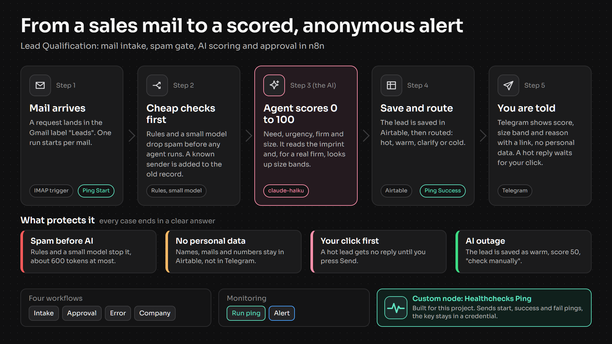
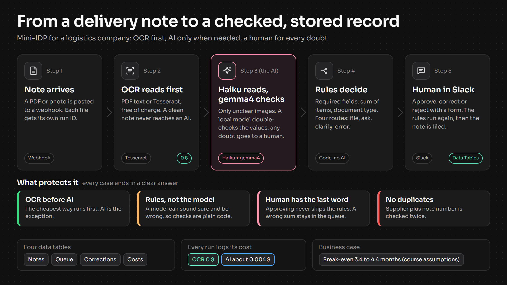

# n8n Workflows

I am currently in an advanced training programme on AI-supported workflow automation. 
These workflows are my practice projects: built in n8n (self-hosted on a VPS), tested against written expectations, with known limits listed openly.

Every workflow has its own folder with an explanation, screenshots and the exported JSON files.

## Workflows

| Workflow | What problem it solves | Folder |
|---|---|---|
| **Compliance Guide** | Before an AI project starts, a consultant needs to know which GDPR and EU AI Act articles apply. A form with fixed rules gives the same checklist with citations for the same answers, and it can be tested. | [compliance-guide](workflows/automation-compliance-guide/) |
| **Lead Qualification** | Sales requests arrive by mail, spam and hot leads sit in the same inbox. Spam is stopped before any expensive AI step, an AI agent scores each real lead, and you are told on Telegram without personal data. A hot reply goes out only after your click. | [lead-qualification](workflows/lead-qualification/) |
| **Mini-IDP Delivery Notes** | A logistics company types about 180 delivery notes a day into its system by hand. Free OCR reads each note first, an AI and a local model read and double-check only the unclear ones, fixed rules decide, and a person in Slack answers every doubt. Every run logs its cost. | [mini-idp-schmidt](workflows/mini-idp-schmidt/) |

### Compliance Guide

- **Problem:** a chat about the law changes with every run and cannot be tested properly. A consultant needs the same, checkable result for the same answers.
- A form with about twenty clickable questions, fixed rules in code, exact retrieval of the legal articles (GDPR, EU AI Act), a checklist with citations. An AI only writes three short sentences per topic from the retrieved text, a code check replaces any summary that cites an article it was not given
- Own community node for Healthchecks pings (TypeScript), error workflow with Telegram alert, daily cost limit of 0.20 EUR
- 19 test cases with expectations written first, 19 of 19 passed, every law article retrieved by at least one case
- [Clickable demo](https://markus-piljanovic.github.io/automation-portfolio/workflows/automation-compliance-guide/page/compliance-guide-demo.html) without any setup and a [test plan](https://markus-piljanovic.github.io/automation-portfolio/workflows/automation-compliance-guide/testing/test-plan.html) as one interactive page

[Read the full description](workflows/automation-compliance-guide/README.md)

### Lead Qualification

- **Problem:** sales requests, spam and hot leads share one inbox. Reading and judging each mail costs time, and an AI reading every spam mail costs money.
- Spam is stopped first by rules and a small model (about 600 tokens), then an AI agent scores each real lead from 0 to 100 with an imprint check and company size bands
- Telegram alerts carry only score, size band, reason and a link, no personal data. A hot reply goes out only after one click on Send
- Own Healthchecks node on a side branch, error workflow with Telegram alert, four workflows in total
- 23 test cases, 22 passed. The open one, a double click on a used button, cannot be triggered by hand
- Seven [step pages](https://markus-piljanovic.github.io/automation-portfolio/workflows/lead-qualification/page/01-intake.html) show each stage with screenshots, and the [test plan](https://markus-piljanovic.github.io/automation-portfolio/workflows/lead-qualification/testing/test-plan.html) is one page

[Read the full description](workflows/lead-qualification/README.md)

### Mini-IDP Delivery Notes

- **Problem:** a logistics company scans, matches and types about 180 delivery notes a day. Sending every note to an AI would cost money and still needs checks.
- OCR reads first and costs nothing. Only unclear images go to Haiku, and a local model (gemma4) double-checks the values. Fixed rules in code, not the model, decide where a note goes
- A person answers in Slack with a click, a correction form or a refusal, and the rules run again after the answer. Duplicates are caught before and after that step
- Every run writes its cost to a table: 0 $ for OCR, about 0.004 $ for an AI-read note. The business case (break-even in 3.4 to 4.4 months) is calculated from course assumptions and says so
- 18 test cases, 16 passed, 2 open and listed openly. Known limits are in the README, for example an open webhook and a local model behind an SSH tunnel
- Six [step pages](https://markus-piljanovic.github.io/automation-portfolio/workflows/mini-idp-schmidt/page/01-intake.html) show each stage with screenshots, and the [test plan](https://markus-piljanovic.github.io/automation-portfolio/workflows/mini-idp-schmidt/testing/test-plan.html) is one page. This is a course project for a fictional company, the notes inside the workflow are in German

[Read the full description](workflows/mini-idp-schmidt/README.md)

## Notes

- Credentials, IDs, table and folder references are replaced by placeholders (`YOUR_..._ID`). The workflows can be imported, but need your own credentials.
- The sticky notes in the workflows explain every step.
