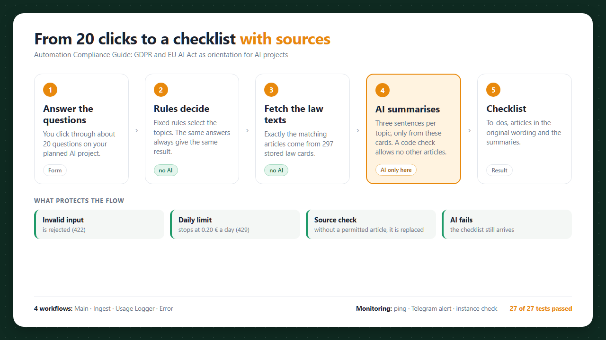
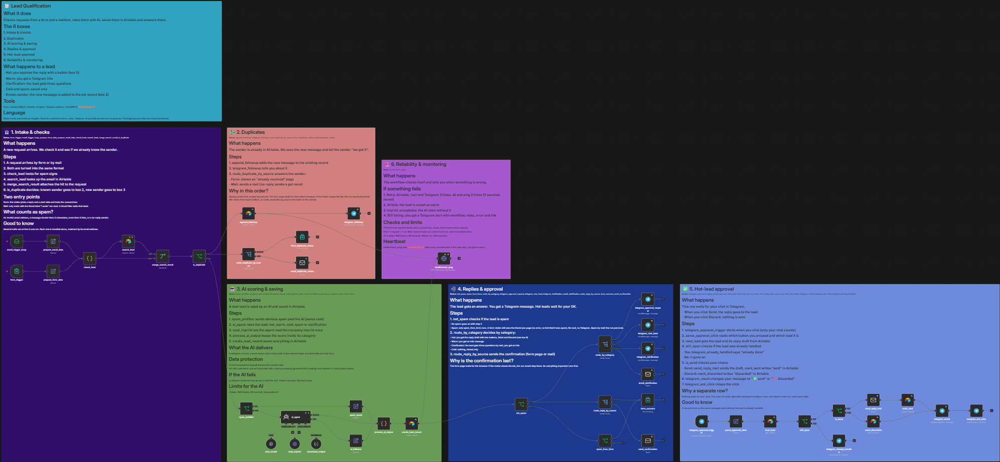

# n8n Workflows

Example workflows from my automation work (n8n, self-hosted on a VPS). Every workflow has its own folder with an explanation, screenshots and the exported JSON files.

## Workflows

| Workflow | What problem it solves | Folder |
|---|---|---|
| **Compliance Guide** | Before an AI project starts, a consultant needs to know which GDPR and EU AI Act articles apply. A form with fixed rules gives the same checklist with citations for the same answers, and it can be tested. | [compliance-guide](workflows/automation-compliance-guide/) |
| **Lead Qualification** | Requests from a form and a mailbox get answered late, and the hot ones get lost in a full inbox. Every slow answer can cost a customer. | [lead-qualification](workflows/lead-qualification/) |

### Compliance Guide

- **Problem:** a chat about the law changes with every run and cannot be tested properly. A consultant needs the same, checkable result for the same answers.
- A form with about twenty clickable questions, fixed rules in code, exact retrieval of the legal articles (GDPR, EU AI Act), a checklist with citations. An AI only writes three short sentences per topic from the retrieved text, a code check replaces any summary that cites an article it was not given
- Own community node for Healthchecks pings (TypeScript), error workflow with Telegram alert, daily cost limit of 0.20 EUR
- 19 test cases with expectations written first, 19 of 19 passed, every law article retrieved by at least one case
- Clickable demo without any setup (`page/compliance-guide-demo.html`) and a test plan as one interactive page

[Read the full description](workflows/automation-compliance-guide/README.md)

### Lead Qualification

- **Problem:** small businesses lose customers and hot requests in a full inbox. Sorting and answering takes time.
- Two entry points (form, mail), duplicate check, AI agent with imprint research
- Categories hot, warm, cold, spam and clarification, with score and reply draft
- Hot-lead replies are approved with two Telegram buttons, without any run waiting
- Retries, AI fallback, error workflow, heartbeat ping, fixed limits for the AI
- Tested live with more than 20 cases

[Read the full description](workflows/lead-qualification/README.md)

## Notes

- Credentials, IDs, table and folder references are replaced by placeholders (`YOUR_..._ID`). The workflows can be imported, but need your own credentials.
- The sticky notes in the workflows explain every step.
