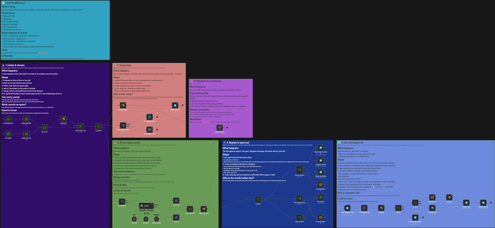

# n8n Workflows

Example workflows from my automation work (n8n, self-hosted on a VPS). Every workflow has its own folder with an explanation, screenshots and the exported JSON files.

## Workflows

| Workflow | What problem it solves | Folder |
|---|---|---|
| **Lead Qualification** | Requests from a form and a mailbox get answered late, and the hot ones get lost in a full inbox. Every slow answer can cost a customer. | [lead-qualification](workflows/lead-qualification/) |
| **Invoice Capture** | Invoices arrive by mail as PDFs, often in other currencies, and are typed into a sheet by hand. That is slow, and missed or double invoices mean late fees and messy books. | [invoice-capture](workflows/invoice-capture/) |

### Lead Qualification

- **Problem:** small businesses lose customers and hot requests in a full inbox. Sorting and answering takes time.
- Two entry points (form, mail), duplicate check, AI agent with imprint research
- Categories hot, warm, cold, spam and clarification, with score and reply draft
- Hot-lead replies are approved with two Telegram buttons, without any run waiting
- Retries, AI fallback, error workflow, heartbeat ping, fixed limits for the AI
- Tested live with more than 20 cases

[Read the full description](workflows/lead-qualification/README.md)

### Invoice Capture

- **Problem:** invoices arrive by mail as PDFs, often in other currencies. Typing them into a sheet is slow and easy to get wrong. Missed or double invoices cost money.
- Runs every night, up to 10 mails per run
- An AI reads the PDF, foreign currencies are converted with the ECB rate of the invoice date
- One row per invoice in Google Sheets, a key prevents double rows, the PDF goes to Google Drive
- Retries, error workflow with Telegram alert, heartbeat ping
- Tested with test PDFs: invoices in euro and other currencies, offers, terms, duplicates

[Read the full description](workflows/invoice-capture/README.md)

## Notes

- Credentials, IDs, table and folder references are replaced by placeholders (`YOUR_..._ID`). The workflows can be imported, but need your own credentials.
- The sticky notes in the workflows explain every step.
