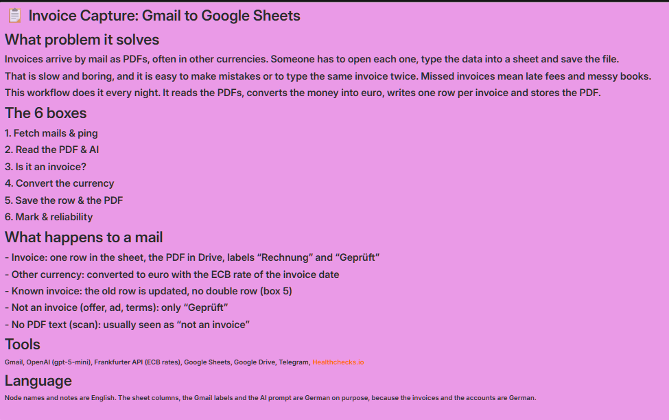
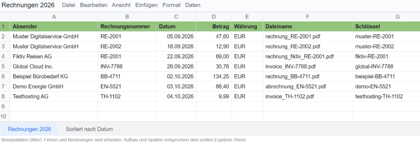
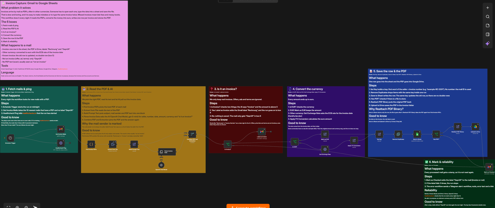
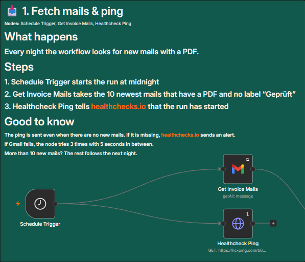
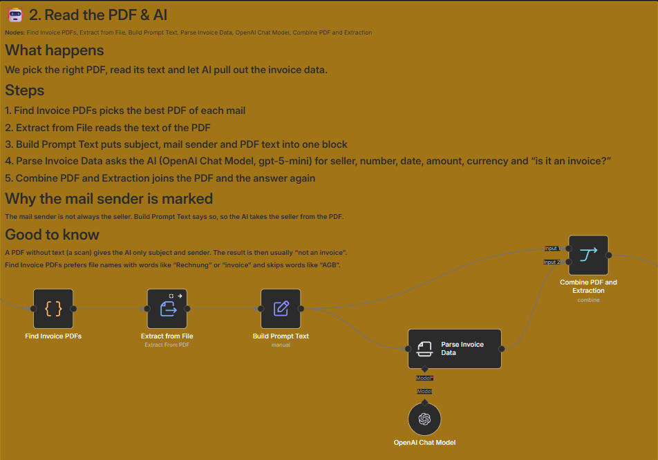
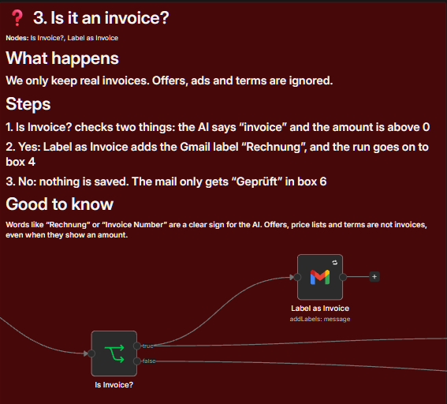
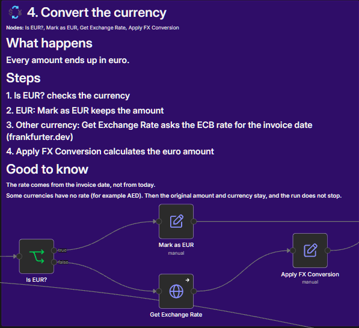
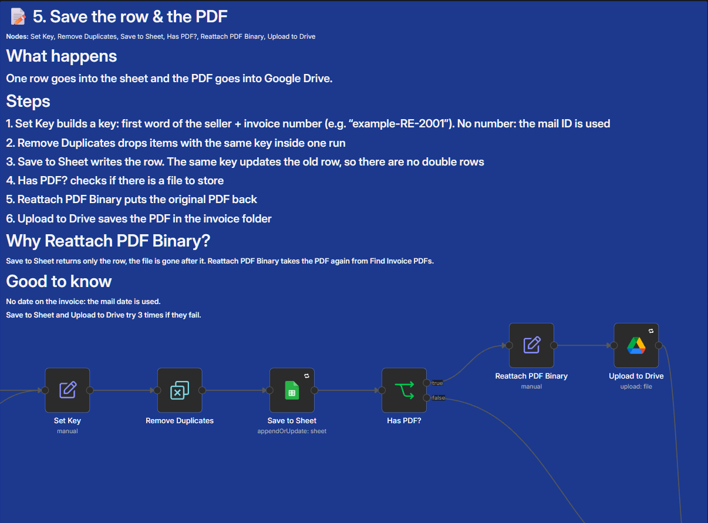
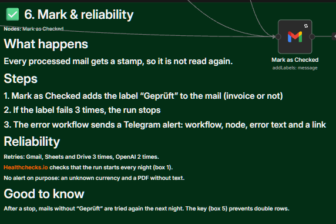

# Invoice Capture: Gmail to Google Sheets

Reads invoice PDFs from Gmail every night, lets an AI extract the data, converts foreign currencies to euro and writes one row per invoice into Google Sheets. The PDF is stored in Google Drive. Built for sole proprietors and small businesses.

## What problem it solves

Invoices arrive by mail as PDFs, often in other currencies. Someone has to open each one, type the data into a sheet and save the file. That is slow and boring, and it goes wrong easily.

Why it matters:
- **Missed invoices cost money.** Late fees and messy books are the result.
- **Typing is error-prone.** Wrong digits, a forgotten invoice, or the same invoice twice.
- **Other currencies add work.** Every foreign amount has to be converted with the rate of the right day.

## How it works

1. **Fetch:** every night at midnight the workflow takes the 10 newest mails in the inbox that have a PDF and no label "Geprüft". A ping tells Healthchecks.io that the run has started.
2. **Read:** it picks the best PDF per mail, reads its text and gives the subject, the mail sender and the text to an AI (gpt-5-mini). The AI returns seller, invoice number, date, amount, currency and whether it is an invoice at all.
3. **Check:** only real invoices go on (the AI says "invoice" and the amount is above 0). They get the Gmail label "Rechnung". Offers, ads and terms are ignored.
4. **Currency:** euro amounts stay as they are. For other currencies the ECB rate of the invoice date is fetched (frankfurter.dev) and the amount is converted.
5. **Save:** one row per invoice goes into Google Sheets. A key (first word of the seller + invoice number) makes sure the same invoice never gets two rows.
6. **PDF:** the original PDF is stored in a Google Drive folder.
7. **Mark:** every processed mail gets the label "Geprüft", invoice or not, so it is not read again tomorrow.

Result in the sheet (example with made-up data):

## The six boxes

The sticky notes in the workflow are numbered like this. The whole canvas looks like this:

**1. Fetch mails & ping**

**2. Read the PDF & AI**

**3. Is it an invoice?**

**4. Convert the currency**

**5. Save the row & the PDF**

**6. Mark & reliability**

## Reliability

- **Retries:** Gmail, Google Sheets and Google Drive nodes try up to 3 times with a 5 second pause. The AI tries 2 times (timeout 60 seconds).
- **Error workflow** sends a Telegram alert (workflow, node, error text, link to the execution).
- **Heartbeat:** a ping to Healthchecks.io right after every start, also when no mail is waiting. If the pings stop, you get an alarm. This also works when n8n or the server is down and the error workflow cannot report anything.
- **Silent on purpose:** an unknown currency (the original amount and currency stay) and a PDF without text (the AI sees only subject and sender, usually "not an invoice").
- **Batch limit:** 10 mails per run. More mails are caught up on the next nights, newest first.
- **No double rows:** the key also protects after an aborted run. Mails without "Geprüft" are tried again the next night.
- **No manual approval on purpose.** This is plain bookkeeping in the background.
- **Data protection:** the AI receives the invoice text (names, addresses, amounts). For customer projects, use an AI provider with a data processing agreement (EU hosting) and mention it in the privacy notice.

## What I learned while testing

I tested with test PDFs: five invoices and five documents that are not invoices (offer, quotation, price list, terms, course info), then more cases (the same invoice number from two sellers, a USD invoice, a THB invoice, an offer). After one fix of the AI instruction, all were sorted correctly and no row was doubled. Five things are interesting for n8n workflows in general:

- **An HTTP node replaces the whole item.** The node that fetches the exchange rate returns only the rate, so the file name and the "has PDF" flag were gone. Apply FX Conversion takes them back from Combine PDF and Extraction, and Reattach PDF Binary brings the file back.
- **The AI does not write names the same way each time.** "Contabo" and "Contabo GmbH" gave two keys and so two rows. The key now uses the first word of the seller in lower case.
- **Never change a key format later.** Rows saved with the old key were not found anymore and got doubled. Mark old mails as done before you change it.
- **Search for the label every mail gets.** The first version searched for "no label Rechnung", so offers and ads were read again every night. Now every processed mail gets "Geprüft".
- **A too strict AI instruction drops real invoices.** The first rule for "is it an invoice" had a long list of exclusions, and real invoices were rated as no invoice. A short list of clear signs plus a few exclusions works better.

## Setup

1. Import both workflows (files below). Replace the placeholders `YOUR_..._ID` with your own credentials and IDs.
2. **Create credentials** and select them in the nodes:
   - Gmail (OAuth), Google Sheets (OAuth), Google Drive (OAuth)
   - OpenAI API key (the export uses `gpt-5-mini`)
   - Telegram bot (and your own chat ID instead of `YOUR_TELEGRAM_CHAT_ID`)
3. **Gmail labels:** create "Geprüft" and "Rechnung" (the names are German on purpose) and select them in the nodes `Mark as Checked` and `Label as Invoice`.
4. **Search start date:** in `Get Invoice Mails` the search contains `after:2025/01/01`. Set your own date. Before the first run, give old mails the label "Geprüft", otherwise the workflow reads your backlog, 10 mails per night.
5. **Google Sheet** with these columns (names are German on purpose): `Absender`, `Rechnungsnummer`, `Datum` (date format), `Betrag`, `Währung`, `Dateiname`, `Schlüssel`. Put your sheet ID and tab ID in place of `YOUR_SHEET_ID` and `YOUR_SHEET_GID`, and your Drive folder ID in place of `YOUR_DRIVE_FOLDER_ID`.
6. **Error workflow:** import it, **activate it**, and select it in the settings of the main workflow.
7. **Ping:** create a check at Healthchecks.io (period 1 day, grace time 1 hour) and put its UUID in the node `Healthcheck Ping` (`YOUR_HEALTHCHECK_UUID`).
8. Optional: add `sort-sheet.gs` in Extensions > Apps Script and a daily time trigger (1 to 2 am). It keeps the sheet sorted by date.

## Known limits

- Only invoices with a **PDF attachment** are read. Invoices that are only in the mail text are not covered.
- A **scan without text** gives the AI only subject and sender. It is usually rated "not an invoice" and ignored without an alert.
- The key uses the first word of the seller. Two different sellers with the same first word and the same invoice number would share one row (rare).
- Upload to Drive does not check for an existing file. If the same mail is processed again, the PDF can be stored twice.
- There is no review step. If the AI reads an amount or a date wrong, nobody notices.
- The AI can make mistakes with unusual layouts. The results are meant for bookkeeping help, not as a replacement for checking.

## Files

- [Invoice Capture.json](Invoice%20Capture.json): main workflow
- [Error Workflow (Invoice Capture).json](Error%20Workflow%20%28Invoice%20Capture%29.json): Telegram alert on errors
- [sort-sheet.gs](sort-sheet.gs): optional Apps Script that sorts the sheet by date

Language: node names and notes are English. The sheet columns, the Gmail labels and the AI instructions are German on purpose, because the invoices and the accounts are German.
