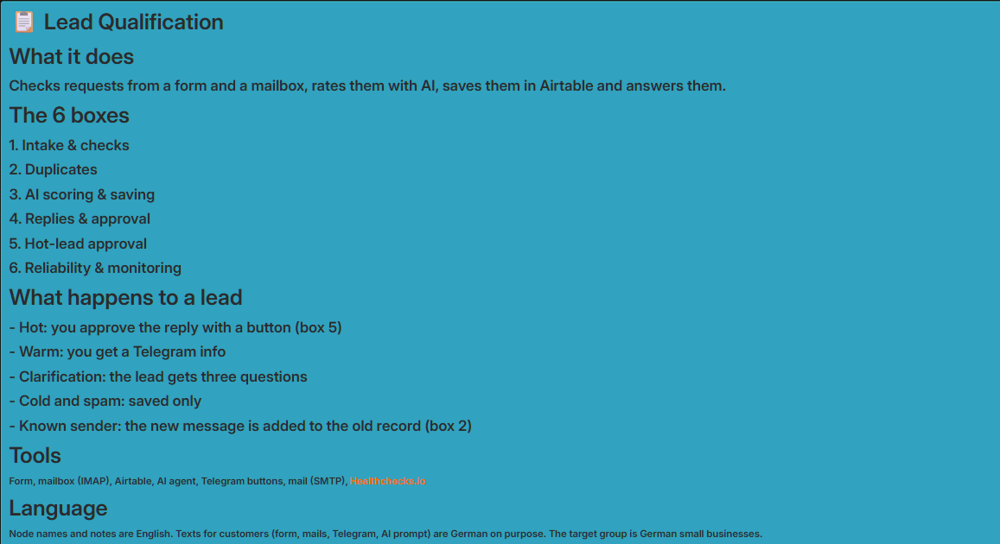
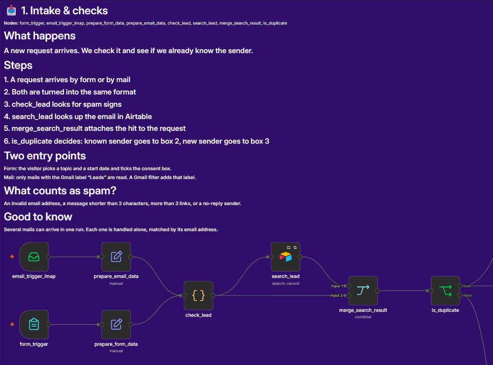
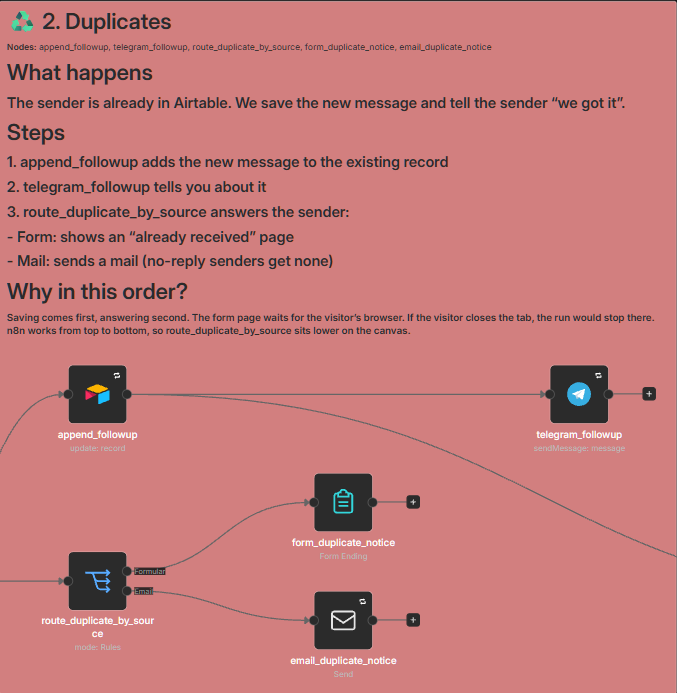
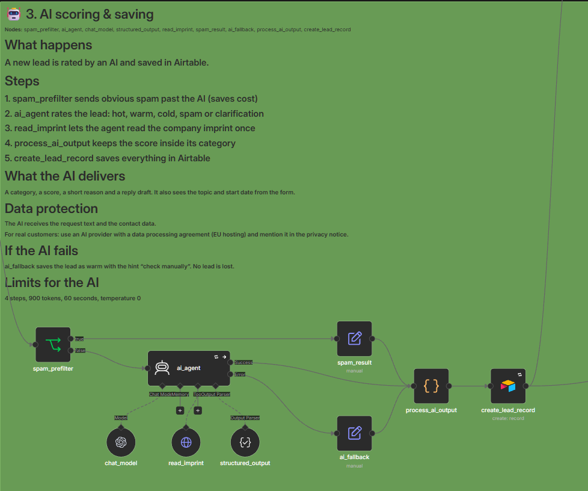
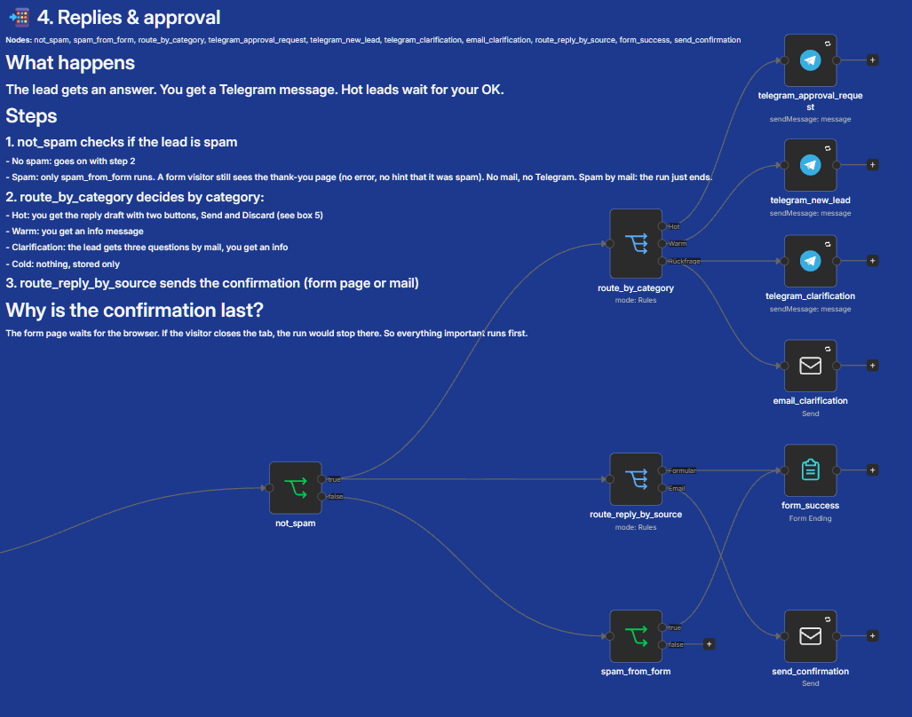
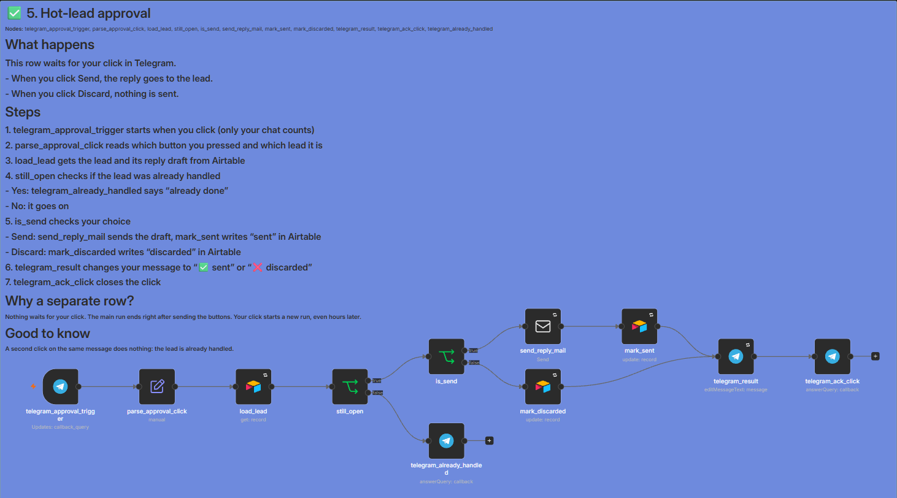
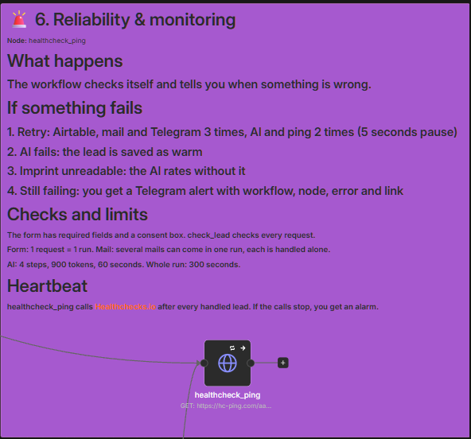
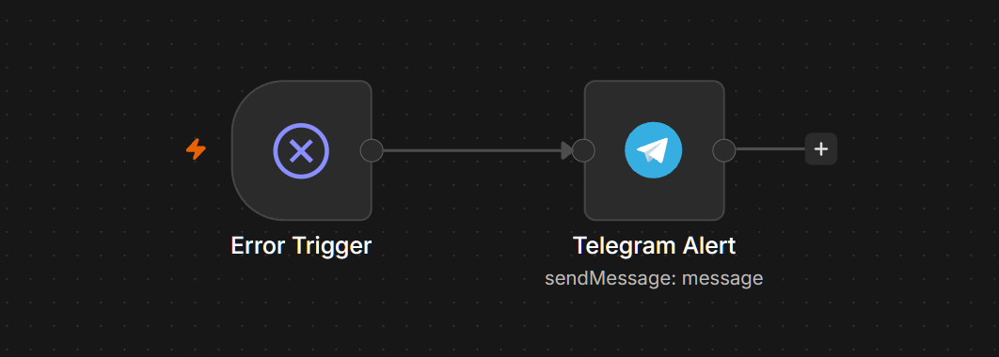

# Lead Qualification

Checks inbound requests from a web form and a mailbox, rates them with an AI, saves them in Airtable and answers them. Built for sole proprietors and small businesses.

## What problem it solves

Small businesses get requests by form and by mail. Someone has to read each one, check if the sender is already known, decide if it is worth a call, and answer. That takes time, and it gets done late or not at all.

Why it matters:
- **Speed wins customers.** A slow first answer often means the customer asks someone else.
- **Hot requests get lost.** In a full inbox, the one request with a budget and a deadline looks like all the others.
- **The owner should decide, not sort.** The workflow reads, checks, rates and writes a reply draft. The owner only confirms the important replies with one click.

## How it works

1. **Two entry points:** a contact form (two dropdowns and a consent checkbox) and a mailbox (only mails with the Gmail label "Leads").
2. **Checks:** both are brought into the same format. Invalid addresses, almost empty messages, too many links and no-reply senders count as spam suspicion and skip the AI (saves cost).
3. **Duplicate check:** Airtable is searched for the email address. If the sender is known, the new message is appended to the existing record, you get a Telegram note, and the sender gets "we already received your request".
4. **AI rating:** an AI agent sets a category (hot, warm, cold, spam or clarification) with score, reason and a reply draft. For company domains it may read the imprint once.
5. **Saving:** every lead is stored in Airtable (status, priority, score, reasoning, research, reply draft).
6. **Replies:**
   - **Hot:** you get the reply draft in Telegram with two buttons, Send and Discard. Nothing waits: the click starts its own run.
   - **Warm:** Telegram info.
   - **Clarification:** the message is too short to rate. The lead gets three questions by mail, you get a Telegram note.
   - **Cold and spam:** stored only.
   - Every real lead gets a confirmation (thank-you page in the form, or a mail).

## The six boxes

The sticky notes in the workflow are numbered like this. The whole canvas looks like this:

**1. Intake & checks**

**2. Duplicates**

**3. AI scoring & saving**

**4. Replies & approval**

**5. Hot-lead approval** (own entry point, starts when you click a button)

**6. Reliability & monitoring**

**Error workflow** (second workflow, sends a Telegram alert)

## How the AI rates

| Category | Score | Meaning | Reaction |
|---|---|---|---|
| hot | 70 to 100 | clear need and a deadline or budget | approval by Telegram button, then mail |
| warm | 40 to 69 | need visible, timing or budget unclear | Telegram info |
| cold | 1 to 39 | general question without a concrete need | stored only |
| clarification | 10 to 39 | too short to rate | three questions by mail, Telegram info |
| spam | 0 | advertising, phishing, off-topic | stored only |

- **The score is forced into the range of its category** in a code node. Category, score, priority and status in Airtable always match.
- **Clarification** is only used if the message shows no need and both form dropdowns (topic, time frame) are empty. If someone writes little but picks a topic and a time frame, the request is rated normally.
- **Temperature 0** on the chat model for steady ratings. It does not remove all variation (the same text got warm 65 once and hot 82 to 85 otherwise), so fixed rules in code back it up.
- **Prompt injection:** the message is wrapped in markers, and the prompt says that text from messages and web pages is data only.
- **If the AI fails**, the lead is stored as **warm with the hint "check manually"**. No lead is lost.

## Reliability

- **Retries:** Airtable, the four mail nodes and the Telegram nodes try up to 3 times with a 5 second pause. The AI and the ping try 2 times.
- **Error workflow** sends a Telegram alert (workflow, node, error text, link to the execution).
- **Silent on purpose:** imprint not readable (the agent rates without research), AI failure (fallback), ping failure.
- **Heartbeat:** a ping to Healthchecks.io after every handled lead. If the pings stop, you get an alarm.
- **Limits for the AI:** 4 steps, 900 tokens, 60 seconds, the imprint is read at most once. Whole run: 300 seconds.
- **Batch limit:** form: 1 request = 1 run. Mail: several mails can arrive in one run. Each request is handled alone, matched to its Airtable hit by email address in the merge node.
- **Data protection:** the AI receives the request text and the contact data. For customer projects, use an AI provider with a data processing agreement (EU hosting) and mention it in the privacy notice.

## What I learned while testing

The workflow was tested live with more than 20 cases (form, mail, simultaneous requests, clarification, approval, error case). It found six bugs that I fixed. Four are interesting for n8n workflows in general:

- **Waiting nodes block the whole run.** The "Form Ending" node waits until the browser fetches the page. If a visitor closes the tab at once, the run stops there and everything after it never runs. n8n works parallel branches **from top to bottom by their position on the canvas**, so the nodes that wait sit lowest. This is also explained in the sticky notes.
- **Approval without waiting.** `Send and Wait` also blocks the run. Instead, the hot-lead message carries two inline buttons and the reply draft is stored in Airtable. A click starts a separate run through a Telegram trigger, loads the record, sends or discards, and marks the record. No run waits for hours, and a second click on the same message does nothing.
- **Merge by position breaks with several items per run.** If the search returns one hit for two leads, the leads get mixed up. The merge node matches by email address instead.
- **An inactive error workflow does nothing.** It has to be active, and the test is an error on purpose.

## Setup

1. Import both workflows (files below). Replace the placeholders `YOUR_..._ID` with your own credentials and IDs.
2. **Create credentials** and select them in the nodes:
   - Airtable personal access token (only for this base, rights `data.records:read`, `data.records:write`, `schema.bases:read`)
   - Telegram bot (and your own chat ID instead of `YOUR_TELEGRAM_CHAT_ID`)
   - SMTP to send and IMAP to receive (for example one mailbox with an app password)
   - an OpenAI-compatible credential for the chat model. The export contains the model name of my test setup (`claude-haiku`). With your own OpenAI account, choose a suitable model.
3. **Airtable table "Leads"** with these columns (names are German on purpose, like the customer-facing texts): `name`, `email`, `telefon`, `unternehmen (optional)`, `datenschutz` (checkbox), `nachricht` (long text), `quelle`, `datum`, `thema`, `zeitrahmen`, `status` (single select), `priorität` (single select), `score` (number), `ki-recherche`, `ki-reasoning`, `antwort-entwurf` (long text), `antwort-status`. Put your base and table ID in place of `YOUR_AIRTABLE_BASE_ID` and `YOUR_AIRTABLE_TABLE_ID`.
4. **Mailbox:** in Gmail, create a filter that gives requests (for example mails to an address with `+leads`) the label "Leads". That label is the mailbox in the node `email_trigger_imap`. Set the `replyTo` address in `email_clarification` to this leads address.
5. **Telegram trigger:** one bot can only have one trigger webhook. If the bot is already used by another workflow with a trigger, use a second bot.
6. **Error workflow:** import it, **activate it**, and select it in the settings of the main workflow.
7. **Ping:** create a check at Healthchecks.io and put its URL in the node `healthcheck_ping` (`YOUR_HEALTHCHECK_UUID`).
8. Optional: set an execution timeout in the workflow settings (300 seconds in my test).

## Known limits

- If a visitor closes the form at once, the main run stays on "waiting" in n8n (it waits for the browser). Everything important is already done by then, only the execution stays open.
- If the same person submits twice in the same second, two records can be created (not tested).
- Leads from mail have no consent checkbox, so the field `datenschutz` stays empty for them.
- The privacy notice itself belongs to the customer's form and is not part of this workflow.

## Files

- [Lead Qualification.json](Lead%20Qualification.json): main workflow (including the hot-lead approval)
- [Error Workflow (Lead Qualification).json](Error%20Workflow%20%28Lead%20Qualification%29.json): Telegram alert on errors

Language: node names and sticky notes are English. Texts the customer sees (form, mails, Telegram messages, AI prompt) are German on purpose, because the target group is German small businesses.
