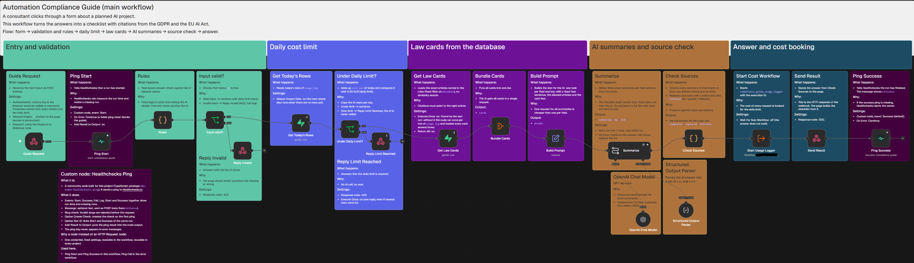

# Automation Compliance Guide

Ein Berater klickt sich durch etwa 20 Fragen zu einem geplanten KI-Projekt und bekommt eine **Checkliste mit Belegen aus DSGVO und EU AI Act**. Nur Orientierung, keine Rechtsberatung.

- **Demo ohne Einrichtung:** [im Browser öffnen](https://markus-piljanovic.github.io/automation-portfolio/workflows/automation-compliance-guide/page/compliance-guide-demo.html) (ein festes Beispiel, Mausrad oder Pfeiltasten wechseln den Schritt)
- **Testplan:** [27 von 27 Fällen bestanden](https://markus-piljanovic.github.io/automation-portfolio/workflows/automation-compliance-guide/testing/test-plan.html)

## Idee

- Feste Regeln im Code wählen die Themen basierend auf den Klick-Antworten der Eingabemaske. Gleiche Antworten ergeben immer das gleiche Ergebnis.
- Die passenden Gesetzesartikel kommen aus einer Datenbank (297 Karten: DSGVO 118, AI Act 179), per exaktem Filter und nicht per Ähnlichkeitssuche.
- Die KI schreibt pro Thema nur drei Sätze aus diesen Karten. Eine Code-Prüfung ersetzt jede Zusammenfassung, die keinen erlaubten Artikel nennt.
- Ein erster Versuch als Chatbot konnte nicht garantieren, dass alle Gesetze abgedeckt sind. Deshalb dieser Aufbau.

## Die Workflows

| Workflow | Datei | Bild | Aufgabe |
|---|---|---|---|
| Main | [`compliance-guide-main.json`](compliance-guide-main.json) | [Screenshot](images/workflows/compliance_guide_main_workflow.png) | Der Weg einer Anfrage, hinter einem öffentlichen Webhook |
| Ingest | [`compliance-guide-ingest.json`](compliance-guide-ingest.json) | [Screenshot](images/workflows/compliance_guide_ingest.png) | Lädt die Gesetzeskarten mit Embeddings in Supabase (einmal von Hand) |
| Usage Logger | [`compliance-guide-usage-logger.json`](compliance-guide-usage-logger.json) | [Screenshot](images/workflows/compliance_guide_usage_logger.png) | Rechnet die KI-Kosten eines Laufs aus und schreibt sie ins Kostenlog |
| Error | [`Error Workflow (compliance-guide).json`](Error%20Workflow%20%28compliance-guide%29.json) | [Screenshot](images/workflows/compliance_guide_error_workflow.png) | Telegram-Nachricht und Fail-Ping an Healthchecks, wenn Main fehlschlägt |

Jede Node hat eine Sticky Note (Was passiert, Warum, Einstellungen).

## Entscheidungen

| Problem | Entscheidung | Verzicht |
|---|---|---|
| Ein Chat-Agent entscheidet selbst, Ergebnisse schwanken | Feste Regeln mit Liste erlaubter Werte und einer Stopp-Regel | Freie Fragen |
| Eine KI kann Artikel erfinden | Nur drei Sätze aus den geladenen Karten, Code-Prüfung der Quellen | Längere Erklärungen |
| Ein Schlüssel in einer Browser-Seite ist öffentlich | Webhook ohne Login, geschützt durch Werteliste, Tageslimit (0,20 €) und reine Klick-Antworten | Anmeldung |
| Stille Fehler sind schlimmer als laute | Eigene Custom Node für Healthchecks plus Error-Workflow mit Telegram | nichts |

## Custom Node: Healthchecks Ping

Quellcode in [`custom-node/`](custom-node/). Sendet Start-, Erfolgs- oder Fail-Pings an Healthchecks.io. Gegenüber einem HTTP-Request-Node liegt der Ping-Schlüssel in einer Credential und taucht nie in Fehlermeldungen auf, und der Slug wird vor dem Senden geprüft. Ein fehlgeschlagener Ping stoppt den Guide nicht.

## Tests

27 Fälle, Erwartungen vorab aus Regelwerk und Gesetzestext, nicht aus dem Gedächtnis: 8 Abdeckung, 1 Regression, 9 Varianten, 6 Fehlerfälle, 3 Sonderfälle (Tageslimit, KI-Ausfall, Fehler im Workflow mit Alarm). Alle 41 Artikel werden mindestens einmal abgerufen. Ein KI-Lauf kostet im Schnitt etwa 0,002 €.

Die Matrix zeigt, welcher Fall welchen Artikel abruft. Ein Klick auf das Bild öffnet den interaktiven [Testplan](https://markus-piljanovic.github.io/automation-portfolio/workflows/automation-compliance-guide/testing/test-plan.html) mit allen 27 Fällen.

Die Aufgabenliste der Maske (23 mögliche Aufgaben, in den Testfällen 7 bis 17 sichtbar) prüft [`testing/check_todos.js`](testing/check_todos.js) ohne Webhook und ohne KI: Der Regel-Code aus dem Main-Workflow läuft für jeden gültigen Fall, danach muss die Liste zu den Antworten passen (zum Beispiel nur mit Angaben über Menschen die Aufgabe zur Rechtsgrundlage je Zweck). Eine ältere Maske ohne die neuen Aufgaben fällt dabei durch (3 von 18 Fällen). Start mit `node testing/check_todos.js`.

Selbst ausführen (nur mit eigenem Workflow, siehe [Einrichten](#einrichten)): Die Adresse deines Webhooks in `GUIDE_URL` setzen und `node testing/run_tests.js` starten. Mit Präfix läuft nur ein Fall, zum Beispiel `node testing/run_tests.js 09`.

## Grenzen

- Die Zusammenfassungen können Wörter aus der Karte nutzen, die nicht im Fakten-Satz stehen. Die Prüfung sichert nur die genannten Artikel, nicht den Wortlaut.
- Der öffentliche Webhook ohne Login ist eine Entscheidung, kein Versehen. Nicht ungeschützt in großem Umfang betreiben.
- Die To-do-Texte sind Entwürfe ohne juristische Prüfung.

## Einrichten

1. Supabase-Projekt anlegen, [`data/schema.sql`](data/schema.sql) ausführen, Credentials in n8n anlegen (Supabase, OpenAI-kompatibel, n8n API lesend, Telegram, Healthchecks).
2. Community Node aus `custom-node/` bauen und installieren (`npm install`, `npm run build`).
3. Die vier JSON-Dateien importieren, `YOUR_...`-Platzhalter ersetzen, im Main-Workflow den Usage Logger und in den Einstellungen den Error-Workflow eintragen.
4. Karten mit [`data/chunking.py`](data/chunking.py) erzeugen (EUR-Lex-HTML beider Gesetze nötig), Ingest einmal ausführen.
5. Usage Logger und Error-Workflow zuerst veröffentlichen, dann Main. Mit `testing/run_tests.js` prüfen.

Zum Ausprobieren der echten Maske: [`page/compliance-guide-form.html`](page/compliance-guide-form.html), die Webhook-Adresse oben im Skript (`GUIDE_URL`) auf den eigenen Webhook setzen.

## Dateien

| Pfad | Inhalt |
|---|---|
| `compliance-guide-*.json`, `Error Workflow ...json` | Die vier Workflows, bereinigt (Platzhalter statt Zugangsdaten und IDs) |
| `custom-node/` | Quellcode der Healthchecks-Ping-Node |
| `page/` | Demo (festes Beispiel) und echte Maske für den eigenen Webhook |
| `data/` | `schema.sql`, `chunking.py` |
| `testing/` | Testplan, 24 automatische Fälle, Testskript, Prüfung der Aufgabenliste |
| `images/` | Screenshots der Workflows und der Datenbank |
