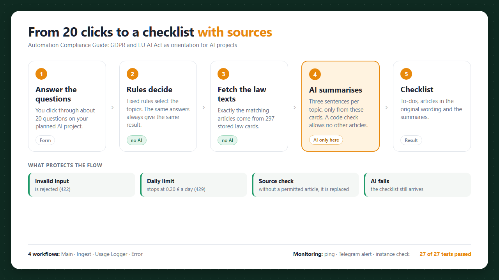
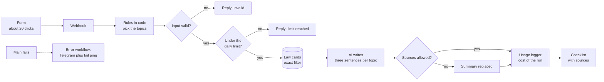

# Automation Compliance Guide

A consultant clicks through about 20 questions on a planned AI project and receives a **checklist with sources from the GDPR and the EU AI Act**.\
For orientation only, not legal advice.

- ▶️ **Demo without setup:** [open in the browser](https://markus-piljanovic.github.io/automation-portfolio/workflows/automation-compliance-guide/page/compliance-guide-demo.html) (one fixed example, mouse wheel or arrow keys change the step)
- ✅ **Test plan:** [27 of 27 cases passed](https://markus-piljanovic.github.io/automation-portfolio/workflows/automation-compliance-guide/testing/test-plan.html)

## 🏗️ Architecture

## 💡 The idea

- Fixed rules in code select the topics from the answers in the form, so identical answers always yield an identical result.
- The matching articles come from a database of 297 cards (GDPR 118, AI Act 179), retrieved by exact filter instead of similarity search.
- The AI writes only three sentences per topic, drawn from those cards.\
  A code check replaces every summary that cites no permitted article.
- A first attempt as a chatbot could not guarantee that every law was covered, which is why the workflow is built this way.

## ⚙️ The workflows

| Workflow | File | Image | Job |
|---|---|---|---|
| Main | [`compliance-guide-main.json`](compliance-guide-main.json) | [Screenshot](images/workflows/compliance_guide_main_workflow.png) | The path of a request, behind a public webhook |
| Ingest | [`compliance-guide-ingest.json`](compliance-guide-ingest.json) | [Screenshot](images/workflows/compliance_guide_ingest.png) | Loads the law cards with embeddings into Supabase (run once, by hand) |
| Usage Logger | [`compliance-guide-usage-logger.json`](compliance-guide-usage-logger.json) | [Screenshot](images/workflows/compliance_guide_usage_logger.png) | Calculates the AI cost of a run and writes it to the cost log |
| Error | [`Error Workflow (compliance-guide).json`](Error%20Workflow%20%28compliance-guide%29.json) | [Screenshot](images/workflows/compliance_guide_error_workflow.png) | Sends a Telegram message and a fail ping to Healthchecks when Main fails |

Every node has a sticky note (what happens, why, settings).

## ⚖️ Decisions

| Problem | Decision | What I gave up |
|---|---|---|
| A chat agent decides for itself, so results vary | Fixed rules with an allow-list of values and a stop rule | Free-form questions |
| An AI can invent articles | Only three sentences from the loaded cards, and a code check on the sources | Longer explanations |
| A key in a browser page is public | A webhook without login, guarded by a value allow-list, a daily cap (0.20 €) and click-only answers | Authentication |
| Silent failures are worse than loud ones | A custom Healthchecks node plus an error workflow with Telegram | Nothing |

## 🧩 Custom node: Healthchecks Ping

The source code is in [`custom-node/`](custom-node/).\
It sends start, success or fail pings to Healthchecks.io.\
Compared with an HTTP Request node, the ping key lives in a credential and never appears in error messages, and the slug is validated before sending.\
A failed ping does not stop the guide.

## ✅ Tests

27 cases, with expectations set in advance from the rule set and the legal text rather than from memory: 8 coverage, 1 regression, 9 variants, 6 error cases and 3 special cases (daily limit, AI outage, a workflow error with alert).\
All 41 articles are retrieved at least once.\
An AI run costs about 0.0023 $ on average (0.002 € at the fixed rate of the usage logger).

The matrix shows which case retrieves which article.\
Clicking the image opens the interactive [test plan](https://markus-piljanovic.github.io/automation-portfolio/workflows/automation-compliance-guide/testing/test-plan.html) with all 27 cases.

To run it yourself (only with your own workflow, see [Setup](#-setup)), put the address of your webhook into `GUIDE_URL` and start `node testing/run_tests.js`.\
With a prefix, only one case runs, for example `node testing/run_tests.js 09`.\
The test inputs are the files in [`testing/cases/`](testing/cases/).

## ⚠️ Known limits

- The summaries may use words from the card that do not appear in the fact sentence.\
  The check secures only the cited articles, not the wording.
- The public webhook without login is a decision, not an oversight.\
  Do not operate it unprotected at scale.
- The to-do texts are drafts without legal review.

## 🚀 Setup

1. Create a Supabase project, run [`data/schema.sql`](data/schema.sql) and create the credentials in n8n (Supabase, OpenAI-compatible, n8n API read-only, Telegram, Healthchecks).
2. Build and install the community node from `custom-node/` (`npm install`, `npm run build`).
3. Import the four JSON files and replace the `YOUR_...` placeholders.\
   In the Main workflow, enter the Usage Logger, and in the settings enter the error workflow.
4. Generate the cards with [`data/chunking.py`](data/chunking.py) (this needs the EUR-Lex HTML of both laws) and run the ingest once.
5. Publish the Usage Logger and the error workflow first, then Main.\
   Verify with `testing/run_tests.js`.

To try the real form, open [`page/compliance-guide-form.html`](page/compliance-guide-form.html) and point the webhook address at the top of the script (`GUIDE_URL`) to your own webhook.

## 📁 Files

| Path | Content |
|---|---|
| `compliance-guide-*.json`, `Error Workflow ...json` | The four workflows, sanitised (placeholders instead of credentials and IDs) |
| `custom-node/` | Source code of the Healthchecks Ping node |
| `page/` | Demo (fixed example) and the real form for your own webhook |
| `data/` | `schema.sql`, `chunking.py` |
| `testing/` | Test plan, 24 automatic cases (the test inputs), test script, check of the to-do list |
| `images/` | Screenshots of the workflows and the database |
