# Automation Compliance Guide

A consultant clicks through approximately 20 questions regarding a planned AI project.
The result is a checklist with citations from the **GDPR (DSGVO)** and the **EU AI Act**.
Addition of more laws is planned - BDSG, tax & labour law, court rulings, guidance of authorities.
PDF-export for user planned.
Not legal advice, orientation only.

**Try it first, no setup needed:** [open the demo in your browser](https://markus-piljanovic.github.io/automation-portfolio/workflows/automation-compliance-guide/page/compliance-guide-demo.html) ([source file](page/compliance-guide-demo.html)) (one fixed example, interface in German, mouse wheel or arrow keys move between the screens).

## What problem does it solve?

The AI consultant gets a first impression of legal requirements before starting out on a client project. 
The result shows the articles in original wording (RAG retrieved) and a three-sentence summary (written by AI) per topic. 
The to-do list comes from fixed rules.
All prompts and output results are currently in German language. 

In the first try I built a chatbot, which couldn't guarantee the coverage of all laws.
This version follows a different approach, have fun exploring:

 

## How it works in n8n

The four workflows:

| Workflow | File | Job |
|---|---|---|
| Ingest | `compliance-guide-ingest.json` | Loads the 297 law cards (GDPR 118, EU AI Act 179) with embeddings into Supabase. Run by hand once and after a law update |
| Main | `compliance-guide-main.json` | The request path for the user input (18 nodes, live behind a public webhook) |
| Usage logger | `compliance-guide-usage-logger.json` | Reads the finished run, calculates the AI cost and writes one row to `usage_log`. Started by the main workflow without waiting |
| Error workflow | `Error Workflow (compliance-guide).json` | Telegram message and a Healthchecks fail ping when the main workflow fails |

The sticky notes explain each node (what happens, why, output, notable settings).

**Main workflow** (the five blocks in detail below the overview):

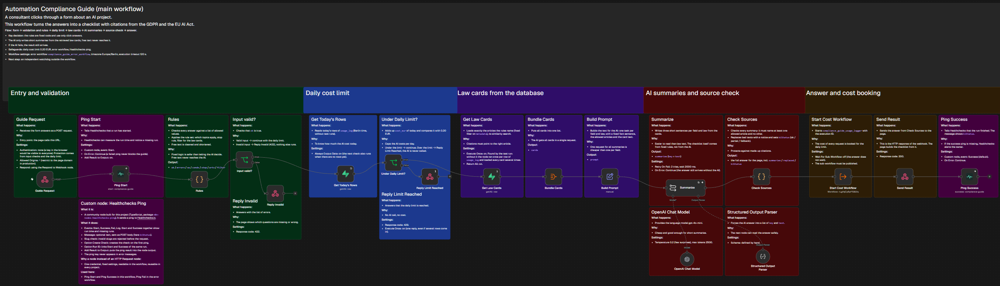

| Entry and validation | Daily cost limit | Law cards from the database |
|---|---|---|
| 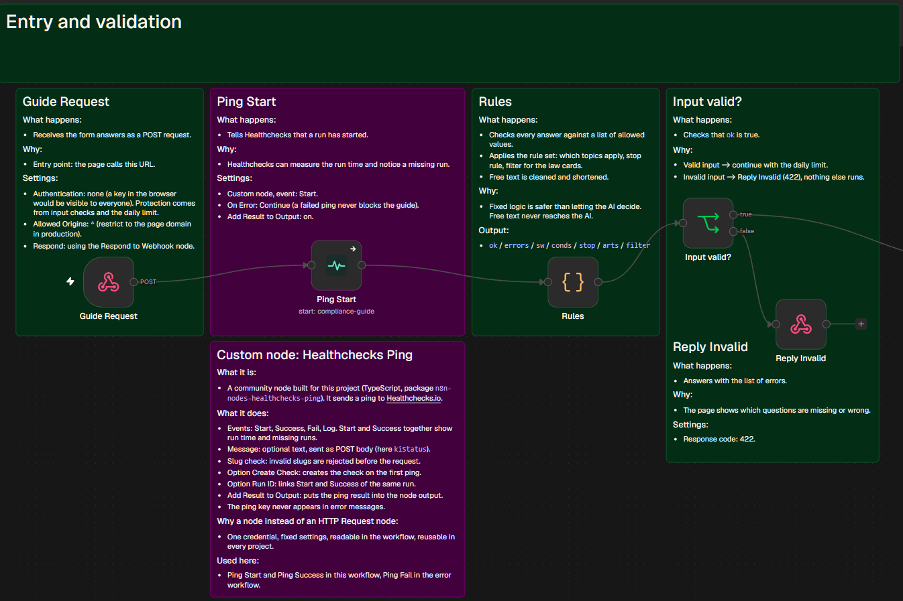 | 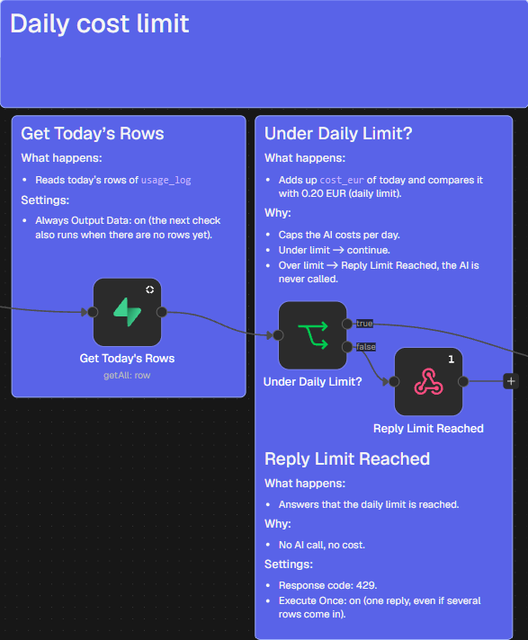 | 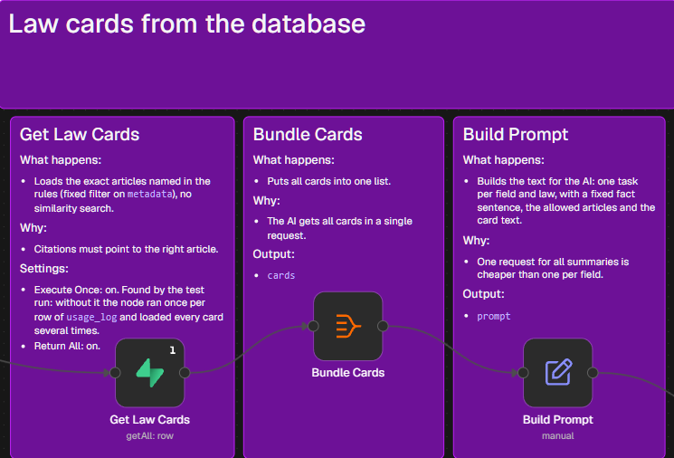 |

| AI summaries and source check | Answer and cost booking |
|---|---|
| 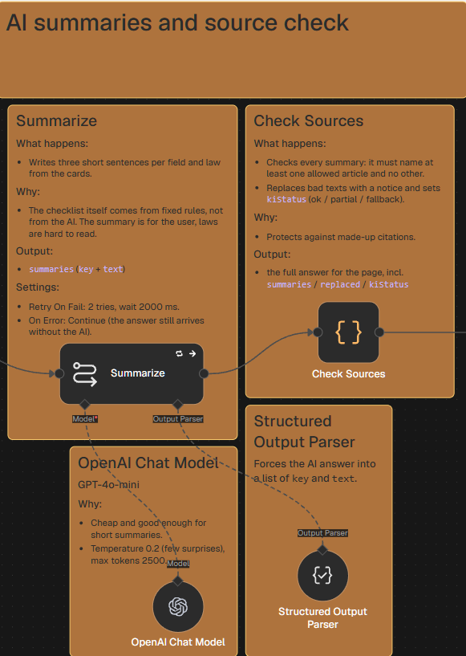 | 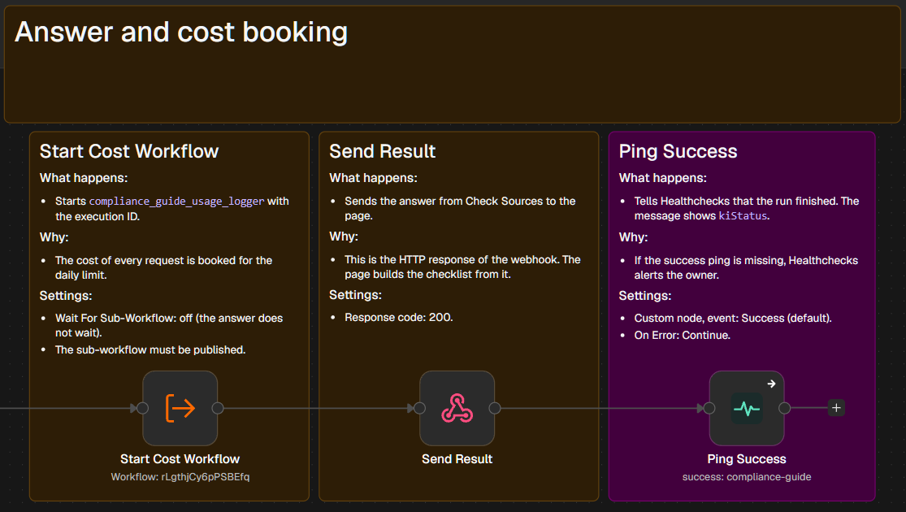 |

**The other three workflows:**

| Ingest | Usage logger | Error workflow |
|---|---|---|
| 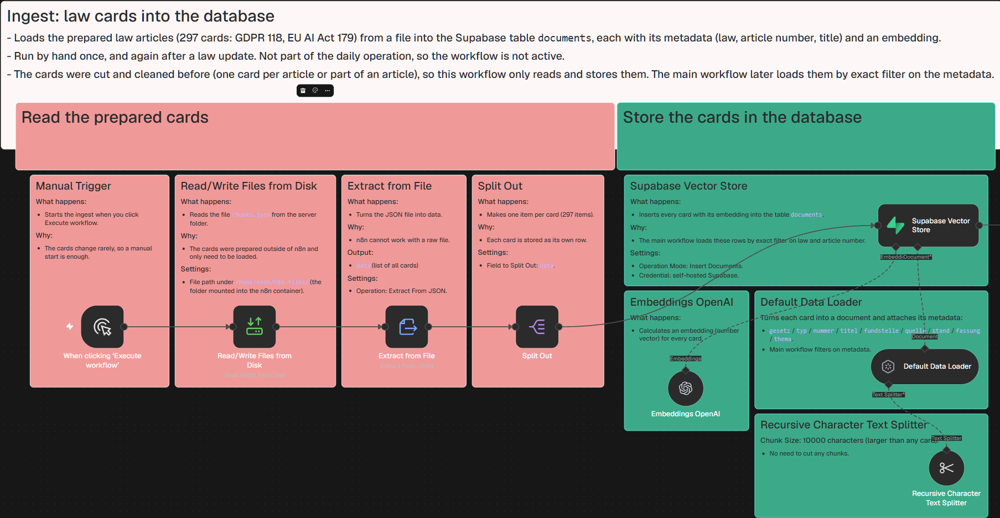 | 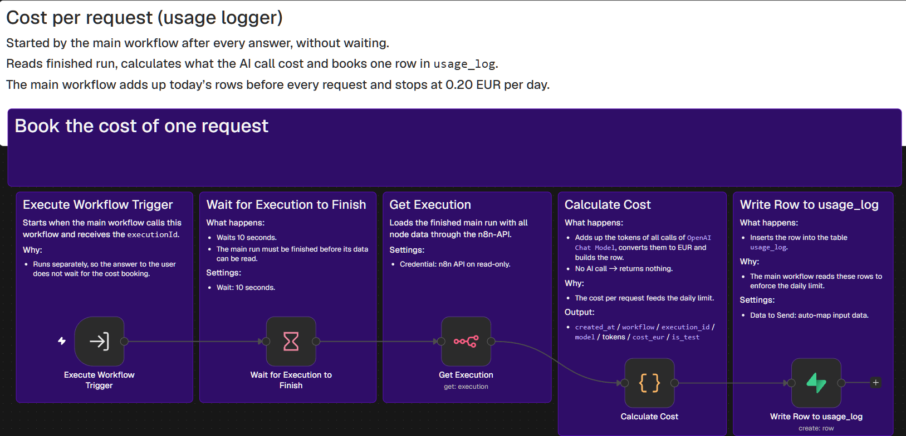 | 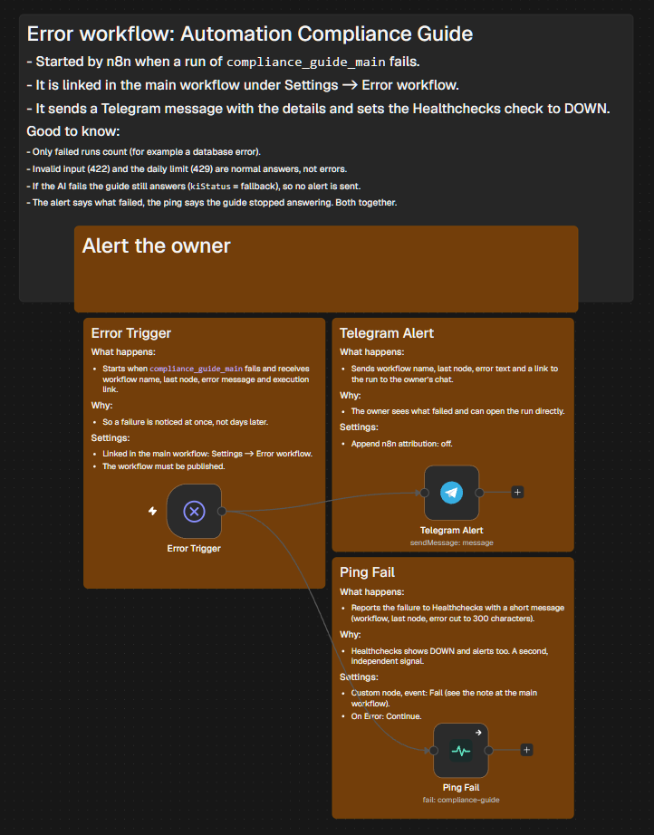 |

### Data

Source: EUR-Lex, German version. 
- GDPR: Official Journal text, retrieved 2026-10-06. 
- EU AI Act: consolidated version of 2026-07-27 (includes the AI Omnibus), retrieved 2026-10-22.
- One card per article, long articles are cut into several cards with the same number. The cards are made by [`data/chunking.py`](data/chunking.py). 
- Every card carries law, article number, title, citation, date and version in its metadata.
- Own Supabase instance for this project (a self-hosted Supabase holds only one project per instance). Tables: [`data/schema.sql`](data/schema.sql).

The tables as they look in Supabase: [law cards with embeddings](images/document_embedding_pgvector_supabase.png), [usage log](images/usage_log_supabase.png), [schema](images/database-schema_sql.png).

## Decisions and trade-offs

| Problem | Decision | What I gave up |
|---|---|---|
| A chat agent decides tools and content itself, results change from run to run and are hard to test | Fixed rules in one code node on click answers (allow-list for every value, a stop rule) | Free questions |
| An AI can invent facts or articles | The AI only writes three short sentences per topic from the retrieved cards. A code node checks that every summary names an allowed article, otherwise the text is replaced | Longer explanations |
| Similarity search can return the wrong article | Exact filter on law and article number | Finding things the rules do not map |
| A key in a browser page is public | Webhook without authentication, protected by allow-list validation, a daily cost limit of 0.20 EUR and click answers only | Authentication (for production: allowed origin, rate limit, captcha) |
| A silent failure is worse than a loud one | Own community node for Healthchecks pings plus an error workflow with Telegram alert | Nothing at run level |

## Custom node: Healthchecks Ping

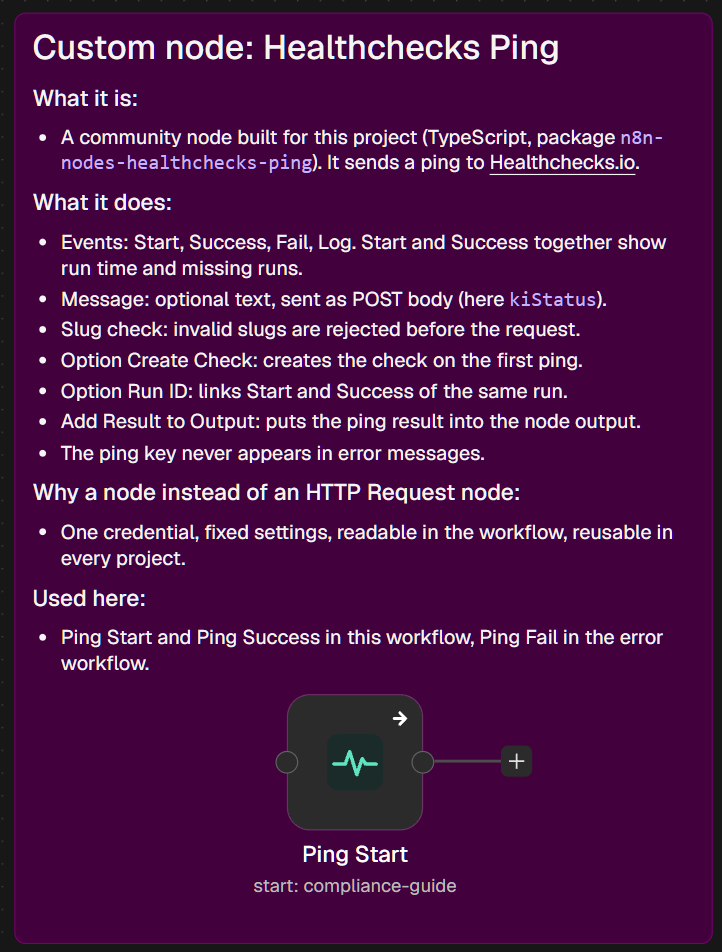

Source in [`custom-node/`](custom-node/). It sends a start, success, fail or log ping to Healthchecks.io. It is used three times: Ping Start and Ping Success in the main workflow, Ping Fail in the error workflow. I found no native n8n node for this, so I built one (community nodes might exist, I did not check).

Compared with an HTTP Request node:

- The ping key is in a credential, not in a URL inside the workflow, and it never appears in error messages (a failing HTTP Request node can put it into execution logs and alerts).
- The slug is checked before sending (lowercase letters, digits, `-`, `_`). Help texts for 404 (no such check), 409 (slug matches several checks) and 429 (rate limit).
- The data passes through unchanged, so the node can sit in the middle of a chain. "Continue On Fail" is supported, a failed ping never stops the guide.
- Options: message as POST body (here `kiStatus`), create check on first ping, run ID to pair start and end.

How the code is organised (about 200 lines, every line has a comment in plain words):

| File | Content |
|---|---|
| [`HealthchecksPing.node.ts`](custom-node/nodes/HealthchecksPing/HealthchecksPing.node.ts) | Section 2 describes the node (fields Event, Check Slug, Message, Options, shown in n8n). Section 3 is `execute()`: validate slug and run ID, build the address, send the ping (GET, or POST when there is a message), turn errors into readable messages without the key, pass the data on |
| [`HealthchecksApi.credentials.ts`](custom-node/credentials/HealthchecksApi.credentials.ts) | The credential form: ping key (hidden) and base URL (cloud or self-hosted) |
| `package.json` | Tells n8n which files are the node and the credential (`n8n` block), build with `npm run build` |

Monitoring works on three levels:

1. **Inside the run:** the ping node reports start, success and fail. Errors inside a run (fail ping), runs that start and never end (start without success after the grace time) and the run time are noticed. The check period is 30 days because the guide only runs on request.
2. **Around the run:** the error workflow (separate workflow, see above) sends a Telegram alert whenever the main workflow fails.
3. **Whole instance:** a separate watcher workflow pings Healthchecks for the n8n instance as a whole, so a down instance is noticed even when no guide run starts.

Only extension left: a watchdog agent that complements or replaces the existing instance watcher workflow.

What the Telegram messages look like (top: a run that failed because of a missing table, which was built in on purpose for the test; bottom: the control run afterwards, check back to UP):

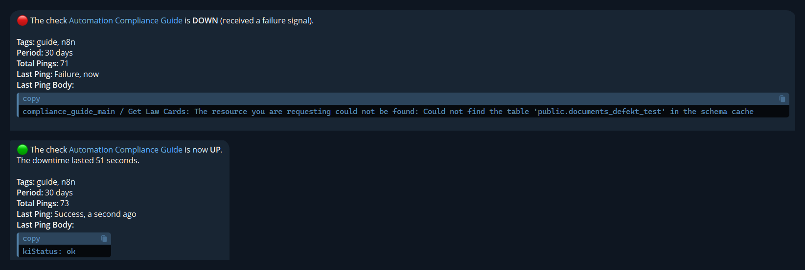

## Testing

19 cases, expectations written **before** the run from the rule set and the law cards, not from memory. [Open the test plan in your browser](https://markus-piljanovic.github.io/automation-portfolio/workflows/automation-compliance-guide/testing/test-plan.html) ([source file](testing/test-plan.html), German interface): pick a case and see the clicked answers, the path of the request, the retrieved articles and the comparison of expected and measured values.

| Group | Cases | Purpose |
|---|---|---|
| Coverage | 8 | Together they retrieve all 41 article targets and set every answer, topic and condition to yes and no |
| Regression | 1 | The demo case runs again to catch damage from later changes |
| Variants | 3 | Everything "I don't know", only own server, free text with an injection attempt |
| Error cases | 4 | Invalid or missing values, empty body: all rejected with 422 |
| Special cases | 3 | Daily limit (429), AI outage (fallback), failure in the workflow (alert) |

Result: **19 of 19 passed**, all 41 articles retrieved, all twelve runs with an AI call cost about 0.03 EUR in total.

The coverage matrix of the test plan shows which case retrieves which article, so no law card is left untested (empty cells are not errors, each request only fetches the articles that match its answers):

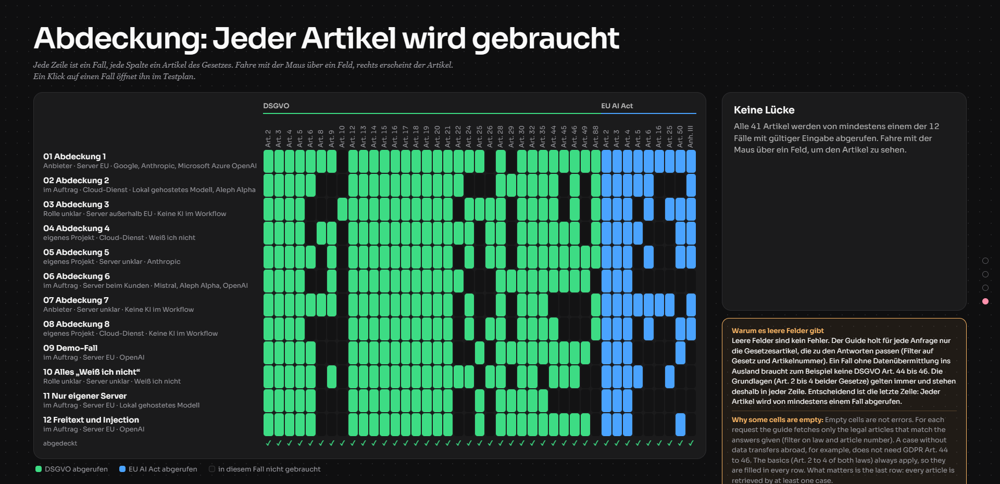

To run the cases yourself: `GUIDE_URL=https://<your-n8n>/webhook/guide-request node testing/run_tests.js` (all cases) or with a file prefix as argument (`... run_tests.js 09`). Inputs and expectations are in `testing/cases/`.

## The demo page

[`page/compliance-guide-demo.html`](page/compliance-guide-demo.html): one fixed example ("Mieter-Chatbot", test case 09) on a fixed 16:9 stage. One screen per step with all its questions, then one result screen. The result starts with the answer as one sentence (how many obligations before the start, how many hints for later), on the left the obligations grouped by topic with the reason taken from your answer, on the right the selected obligation with what to do, who does it, why, and the law text. "Create guide" does not call a server. It waits a few seconds and shows the real answer the guide gave to exactly these answers in the test run.

## Known limits

- The summaries sometimes use words that are in the card but not in the fact sentence (for example "consent" for some answers). The check only guarantees the cited articles, not the wording.
- The Telegram alert uses Markdown and swallows underscores in names.
- A public webhook without authentication is a decision, not an oversight (see above). Do not run it unprotected on a large scale.
- No legal review of the to-do texts. They are drafts.

## Setup

1. Create a Supabase project and run [`data/schema.sql`](data/schema.sql). Create the credentials in n8n (Supabase, OpenAI-compatible, n8n API with read-only rights, Telegram, Healthchecks).
2. Install the community node from `custom-node/` (`npm install` and `npm run build`, then install the package into the n8n nodes folder; with n8n 2.x use `npm install <package> --legacy-peer-deps` there).
3. Import the four JSON files. Replace the `YOUR_...` placeholders (credentials, chat ID, workflow IDs). In the main workflow set the usage logger in "Start Cost Workflow" and the error workflow in the workflow settings.
4. Make the cards with [`data/chunking.py`](data/chunking.py) (needs the EUR-Lex HTML files of both laws), put `chunks.json` in the folder the ingest workflow reads, run the ingest once.
5. Publish the usage logger and the error workflow first (n8n only calls published workflows), then the main workflow. Test it with `testing/run_tests.js` (see Testing).

## Files

| Path | Content |
|---|---|
| `compliance-guide-*.json`, `Error Workflow (compliance-guide).json` | The four workflows, sanitized (placeholders instead of credentials and IDs) |
| `custom-node/` | Source of the Healthchecks Ping community node (TypeScript) |
| `page/compliance-guide-demo.html` | Demo without any setup: one fixed example and its recorded real answer |
| `data/` | `schema.sql` (tables `documents` and `usage_log`), `chunking.py` (law texts to cards) |
| `testing/` | `test-plan.html` (open in a browser), 16 automatic cases, test script, question texts |
| `images/` | Screenshots of the workflows, the database, the alerts and the tests |
