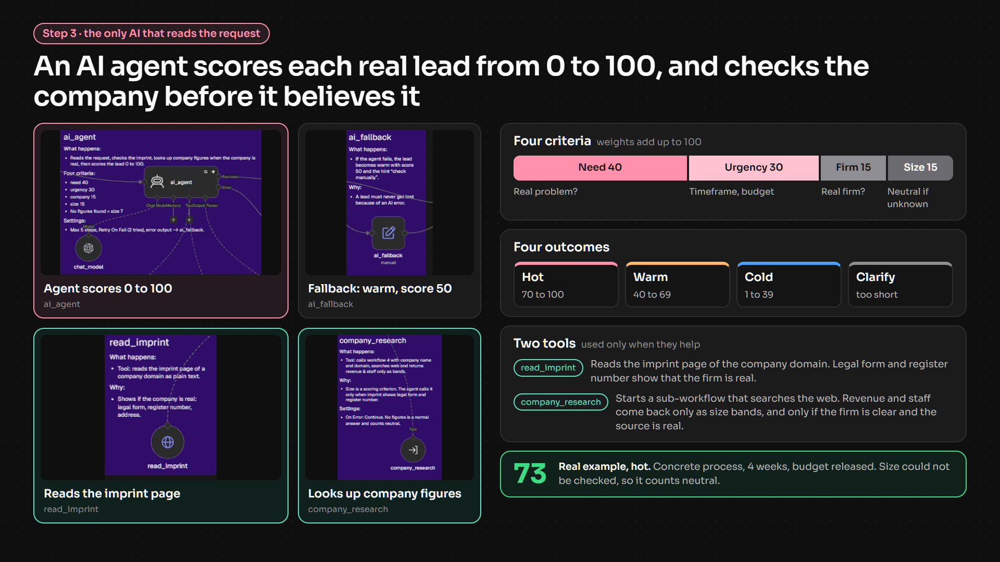
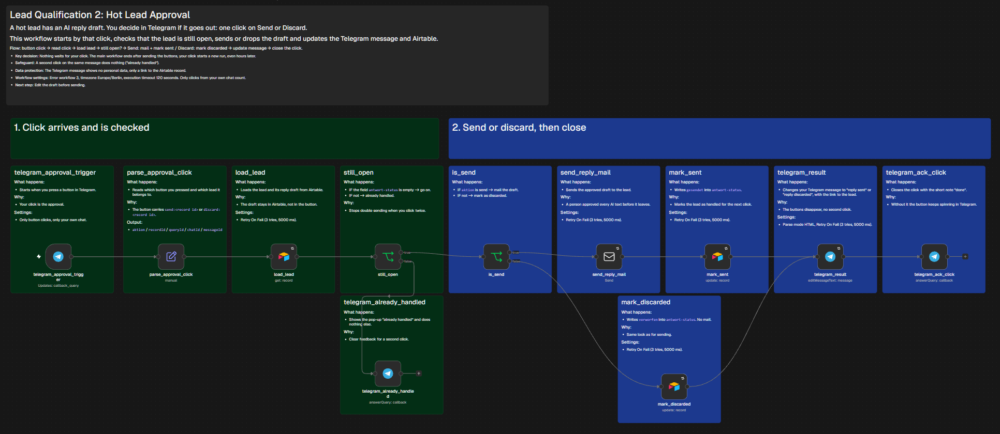
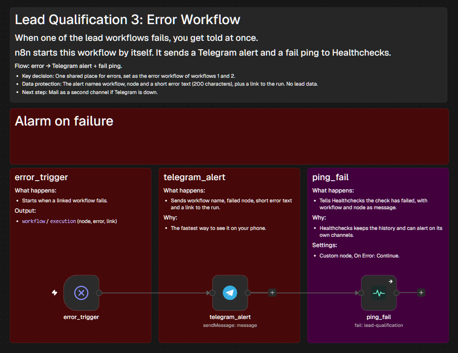

# Lead Qualification

An automation business gets sales requests by mail. This workflow reads each mail, drops spam before any expensive AI step, scores the lead from 0 to 100 with an AI agent, saves it in Airtable and tells you on Telegram, without personal data. A hot lead gets a reply only after you press Send.

Scope: mail intake, spam gate, duplicate check, AI scoring with an imprint check and company size bands, storage, anonymous alerts, approval and monitoring. Planned: re-score a lead when a follow-up mail adds new facts.

Mails, prompts and replies are in German. The workflows, notes and this page are in English.

## Walk-through

Each page is one step of the path. Open them in the browser ([source files in `page/`](page/)), or look at the images here.

| Step | What you see | Page |
|---|---|---|
| 1 | Four free rule checks decide whether a mail is worth any AI | [open](https://markus-piljanovic.github.io/automation-portfolio/workflows/lead-qualification/page/01-intake.html) |
| 2 | A small model catches the spam the rules miss, a known sender is never scored twice | [open](https://markus-piljanovic.github.io/automation-portfolio/workflows/lead-qualification/page/02-spam-and-duplicates.html) |
| 3 | The agent scores need, urgency, firm and size, and checks the company | [open](https://markus-piljanovic.github.io/automation-portfolio/workflows/lead-qualification/page/03-ai-scoring.html) |
| 4 | Every lead is saved in Airtable, then routed as hot, warm, clarify or cold | [open](https://markus-piljanovic.github.io/automation-portfolio/workflows/lead-qualification/page/04-storage-and-routing.html) |
| 5 | Telegram shows score, size band and reason, names and mails stay in Airtable | [open](https://markus-piljanovic.github.io/automation-portfolio/workflows/lead-qualification/page/05-telegram-and-dossier.html) |
| 6 | Nothing goes to a hot lead until you press Send | [open](https://markus-piljanovic.github.io/automation-portfolio/workflows/lead-qualification/page/06-hot-lead-approval.html) |
| 7 | Pings and an alert workflow tell you when something breaks | [open](https://markus-piljanovic.github.io/automation-portfolio/workflows/lead-qualification/page/07-monitoring.html) |

## The workflows

| Workflow | File | Job |
|---|---|---|
| 1 Intake and Scoring | `lead-qualification-1-intake-and-scoring.json` | Reads the mail, checks, scores, saves, routes, alerts |
| 2 Hot Lead Approval | `lead-qualification-2-hot-lead-approval.json` | Starts with your click on Send or Discard |
| 3 Error Workflow | `lead-qualification-3-error-workflow.json` | Telegram alert and fail ping when a run breaks |
| 4 Company Research | `lead-qualification-4-company-research.json` | Tool for the agent: web search, size bands only |

The sticky notes in each workflow explain every node (what happens, why, output, notable settings).

| Hot lead approval | Company research | Error workflow |
|---|---|---|
|  |  |  |

## Decisions and trade-offs

| Problem | Decision | What I gave up |
|---|---|---|
| Spam would cost an AI run | Rules first, then a small model (about 600 tokens), the agent only for real new leads | A borderline mail is judged by the small model alone |
| Personal data in a chat app | Telegram gets score, size band, reason and a link, a code step strips names, mails and numbers | You open Airtable for details |
| An AI must not mail customers alone | A hot reply waits for your click, an AI outage saves the lead as warm | Slower than fully automatic |
| Company size is often unknown | The company tool runs only for a real firm, answers only as bands, and checks its own result in code | Many leads score size as neutral |
| A failed ping could swallow a lead | The custom Healthchecks node sits on a side branch | In bursts a few pings are missing on the dashboard |

## Testing

[Open the test plan in your browser](https://markus-piljanovic.github.io/automation-portfolio/workflows/lead-qualification/testing/test-plan.html) ([source file](testing/test-plan.html)). Inputs and expectations are in [`testing/cases.json`](testing/cases.json).

| Group | Cases | Purpose |
|---|---|---|
| Scoring | 6 | Hot, warm, cold, clarify, English request |
| Spam and rules | 4 | Short text, no-reply sender, too many links, SEO advert |
| Duplicate | 1 | Follow-up mail is appended, no second AI run |
| Tricks and failures | 4 | Prompt injection, fictional company, very long text, ping failure |
| Data protection | 1 | No name, mail or number in Telegram |
| Live and manual | 6 | Real IMAP mails, Send and Discard, error workflow |
| Code check | 1 | Eight checks of the company tool's minimum criteria |

Result: **22 of 23 passed**. The open case is the second click on a used button: Telegram removes the buttons after the first click, so it cannot be triggered by hand. Several findings were fixed during testing, for example a ping that lost leads and an alert that Telegram refused.

## Known limits

- The score is not recalculated when a follow-up mail adds new facts.
- Small firms and free-mail senders usually get no size figures, so size counts as neutral (7 of 15 points).
- Gmail's own spam filter acts before n8n, so very obvious spam never reaches the label.
- In bursts (several mails in the same second) Healthchecks refuses some pings. No lead is lost.
- The IMAP trigger reads all unread mails of the label. Mark old mails as read before you activate the workflow.

## Setup

1. Create an Airtable table `Leads` with the fields `name`, `status`, `email`, `telefon`, `unternehmen (optional)`, `nachricht`, `ki-recherche`, `ki-reasoning`, `score`, `priorität`, `datum`, `quelle`, `antwort-entwurf`, `antwort-status`.
2. Create the credentials: IMAP, SMTP, Airtable, Telegram, an OpenAI-compatible AI endpoint, a header auth for Tavily search and Healthchecks. Install the custom node from [`../automation-compliance-guide/custom-node`](../automation-compliance-guide/custom-node).
3. Create a Gmail filter that puts sales requests under the label `Leads`.
4. Import the four JSON files and replace the `YOUR_...` placeholders. In `check_lead`, replace the pattern for your own sender address.
5. Activate workflow 4, then 3 and 2, then 1. Set workflow 3 as the error workflow of workflows 1 and 2, with an execution timeout of 300 seconds.

## Files

| Path | Content |
|---|---|
| `lead-qualification-*.json` | The four workflows, sanitized |
| `page/` | The seven step pages as single HTML files, no setup needed |
| `testing/` | `test-plan.html` and `cases.json` |
| `images/` | Overview, step pages and workflow screenshots |
