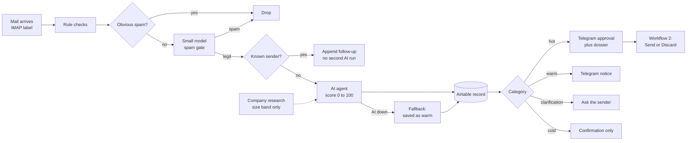
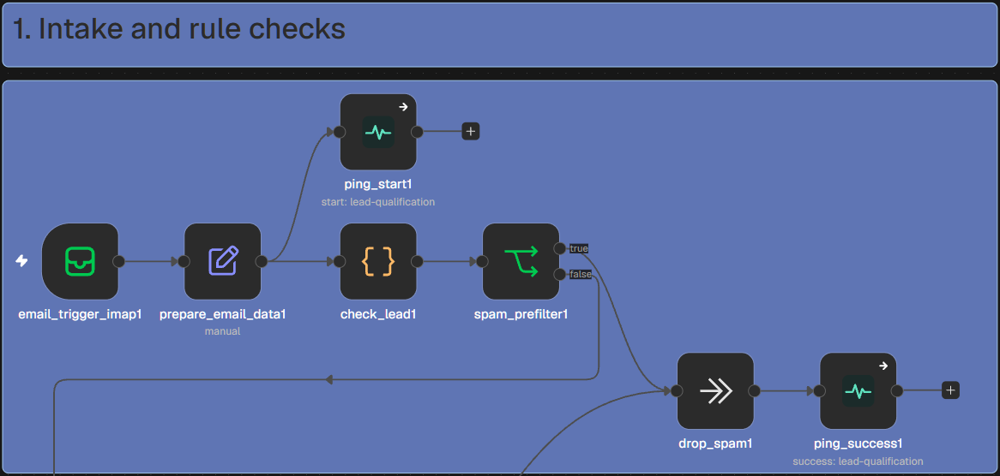
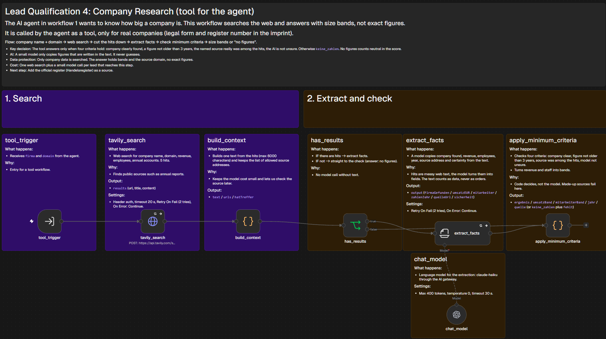

# Lead Qualification

An automation agency receives its inquiries by mail.\
This workflow reads each message, filters spam before any AI runs, and scores the lead.\
It stores the lead in a database (Airtable) and announces it by messenger (Telegram) without personal data.\
A reply to a hot lead leaves only after a human clicks **Send**.

Mails, prompts and replies are in German, while the workflows and the notes inside them are in English.

**[Open the interactive demo](https://markus-piljanovic.github.io/automation-portfolio/workflows/lead-qualification/demo/index.html)**: click through six cases, node by node.

## Architecture

## Workflow layout

The whole workflow is on the left, and the four sections are shown in detail on the right.

<table>
<tr>
<td rowspan="2" width="22%" valign="top"> Full workflow</td>
<td width="39%" valign="top"> <b>1</b> Mail arrives, rules are checked</td>
<td width="39%" valign="top"> <b>2</b> Spam filter and duplicates</td>
</tr>
<tr>
<td valign="top"> <b>3</b> The AI scores the lead</td>
<td valign="top"> <b>4</b> Store and distribute</td>
</tr>
</table>

## The workflows

| Workflow | File | Job |
|---|---|---|
| 1 Intake and Scoring | `lead-qualification-1-intake-and-scoring.json` | Reads the mail, checks, scores, stores, distributes and reports |
| 2 Hot Lead Approval | `lead-qualification-2-hot-lead-approval.json` | Starts with your click on Send or Discard |
| 3 Error Workflow | `lead-qualification-3-error-workflow.json` | Sends a Telegram alert and a fail ping when a run aborts |
| 4 Company Research | `lead-qualification-4-company-research.json` | Tool for the agent: web search, size bands only |

The sticky notes in every workflow explain each node: what happens, why, the output and the key settings.

| Hot Lead Approval | Company Research | Error Workflow |
|---|---|---|
|  |  |  |

## Decisions and trade-offs

| Problem | Decision | What I gave up |
|---|---|---|
| Spam would cost an AI run | Rules first, then a small model (about 600 tokens), and the agent only for genuine new leads | A borderline mail is judged by the small model alone |
| Personal data in a chat app | Telegram receives the score, size band, reasoning and a link, and a code step strips names, mail addresses and numbers | For details, you open Airtable |
| An AI must not write to customers on its own | The reply to a hot lead waits for your click, and if the AI is down the lead is saved as warm | Slower than fully automatic |
| Company size is often unknown | The research tool runs only for a real company, answers in bands only and verifies its own result in code | With many leads, size counts as neutral |
| A failed ping could swallow a lead | The custom Healthchecks node sits on a side branch | In bursts, single pings are missing from the dashboard |

## Tests

[Open the test plan in your browser](https://markus-piljanovic.github.io/automation-portfolio/workflows/lead-qualification/testing/test-plan.html) ([source file](testing/test-plan.html)).\
Inputs and expectations are in [`testing/cases.json`](testing/cases.json).

| Group | Cases | Purpose |
|---|---|---|
| Scoring | 6 | Hot, warm, cold, clarification, an English inquiry |
| Spam and rules | 4 | Short text, no-reply sender, too many links, SEO advertising |
| Known senders | 1 | A follow-up is appended, with no second AI run |
| Tricks and edge cases | 4 | Prompt injection, invented company, very long text, ping outage |
| Privacy | 1 | No name, mail address or number in Telegram |
| Approval by click | 3 | Send, discard, second click |
| Live run and monitoring | 4 | Real IMAP mails, error workflow |

Result: **22 of 23 passed**.\
The open case is the second click on a used button: Telegram removes the buttons after the first click, so it cannot be triggered by hand.\
Several findings were fixed along the way, for example a ping that lost leads and an alert that Telegram rejected.

## Known limits

- The score is not recalculated when a follow-up mail brings new facts.
- Small companies and free-mail senders rarely yield size data, so size counts as neutral (7 of 15 points).
- Gmail's spam filter acts before n8n, so blatant spam never reaches the label.
- In bursts (several mails within the same second), Healthchecks rejects single pings, but no lead is lost.
- The IMAP trigger reads every unread mail under the label, so mark old mails as read before activating.

## Setup

1. Create an Airtable table `Leads` with the fields `name`, `status`, `email`, `telefon`, `unternehmen (optional)`, `nachricht`, `ki-recherche`, `ki-reasoning`, `score`, `priorität`, `datum`, `quelle`, `antwort-entwurf` and `antwort-status`.
2. Create the credentials: IMAP, SMTP, Airtable, Telegram, an OpenAI-compatible AI connection, a header auth for the Tavily search and Healthchecks.\
   Install the custom node from [`../automation-compliance-guide/custom-node`](../automation-compliance-guide/custom-node).
3. Create a Gmail filter that files sales inquiries under the label `Leads`.
4. Import the four JSON files and replace the `YOUR_...` placeholders.\
   In `check_lead`, replace the pattern for your own sender address.
5. Activate workflow 4, then 3 and 2, then 1.\
   Set workflow 3 as the error workflow of workflows 1 and 2, with an execution timeout of 300 seconds.

## Files

| Path | Content |
|---|---|
| `lead-qualification-*.json` | The four workflows, sanitised |
| `demo/` | Interactive demo, one page with scripts, no setup needed |
| `testing/` | `test-plan.html` and `cases.json` |
| `images/` | Overview image, step pages and workflow screenshots |
