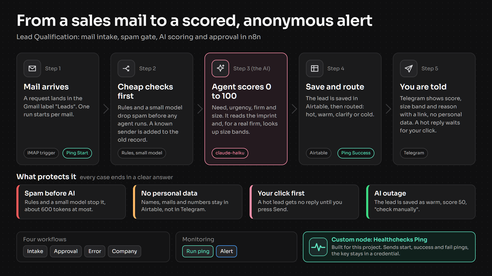
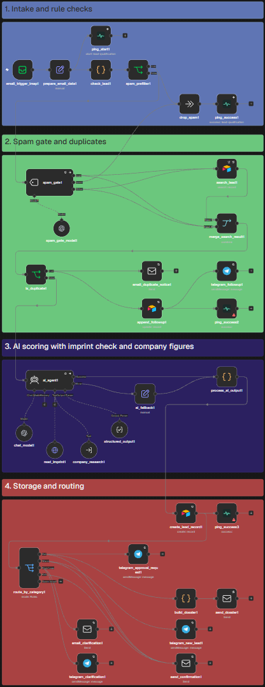
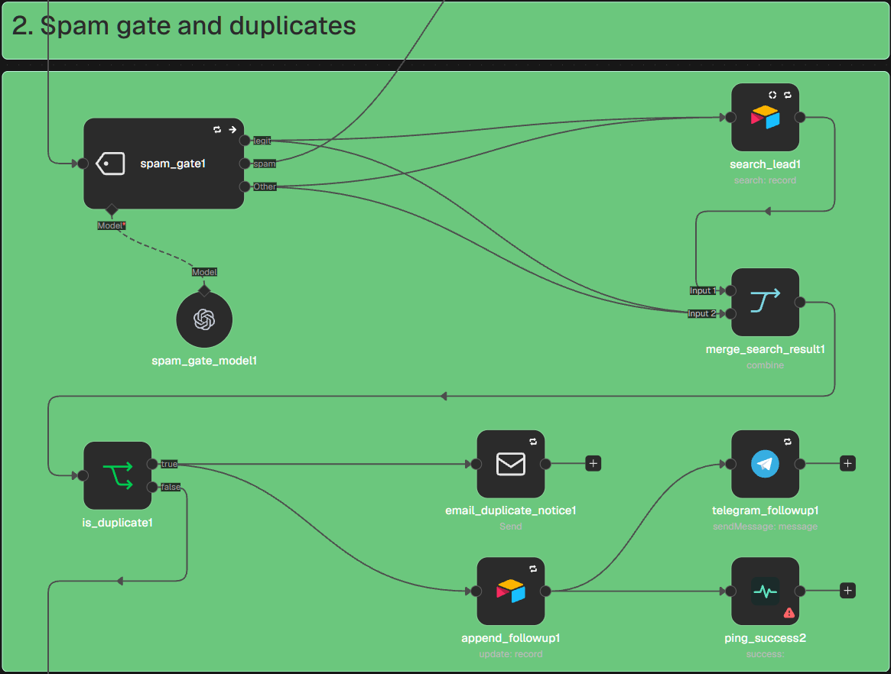
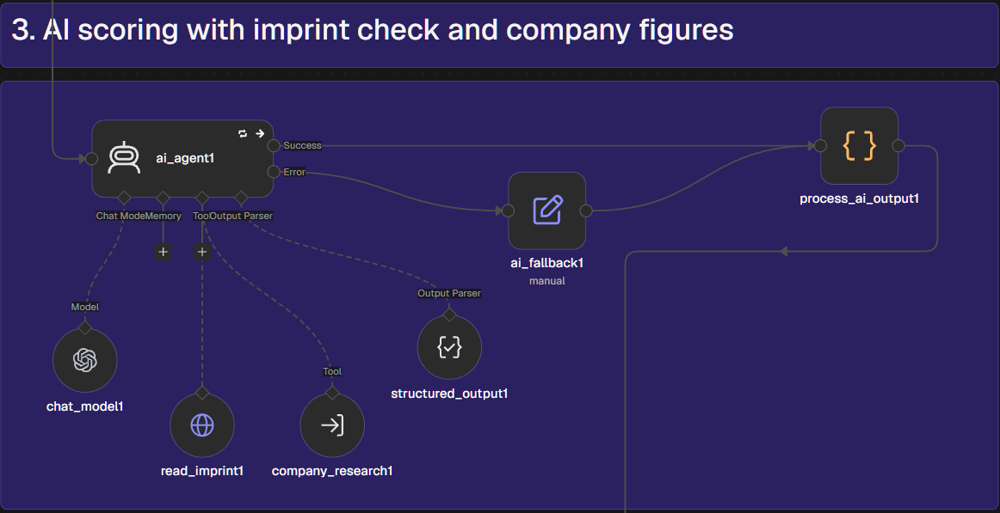
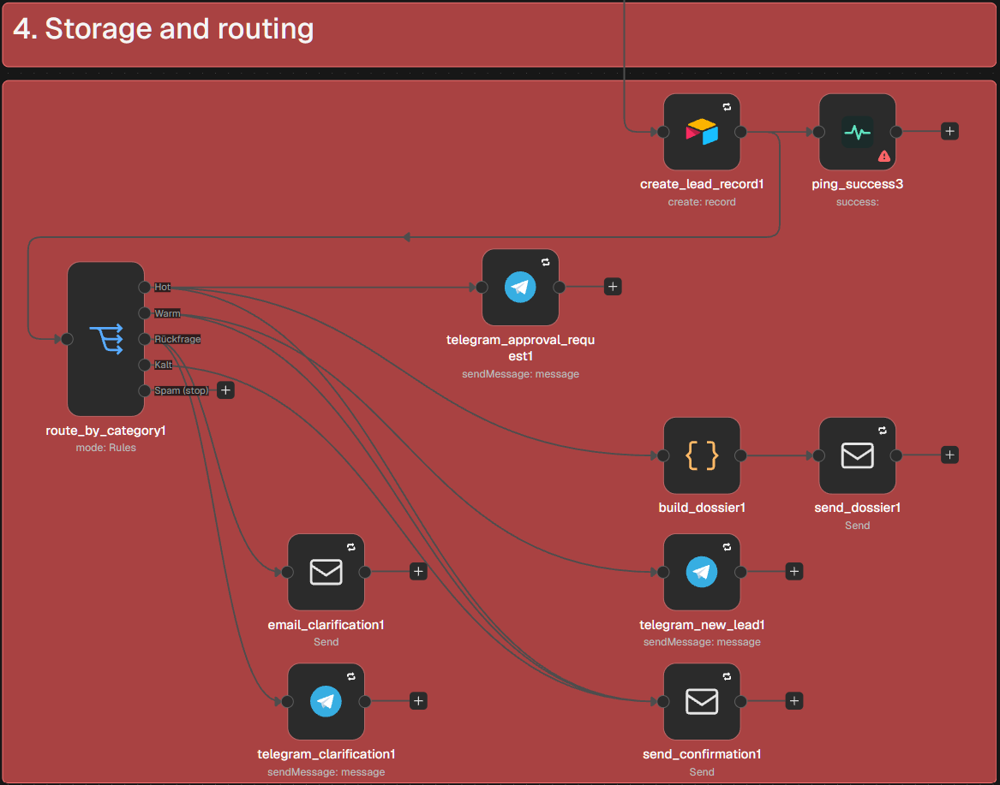

# Lead Qualification

Ein Automatisierungsunternehmen bekommt Anfragen per Mail. Dieser Workflow liest jede Mail, stoppt Spam, bevor ein teurer KI-Schritt läuft, bewertet den Lead mit einem KI-Agenten von 0 bis 100, speichert ihn in Airtable und meldet ihn per Telegram, ohne Personendaten. Eine Antwort an einen heißen Lead geht erst nach einem Klick auf Senden raus.

Umfang: Mail-Eingang, Spam-Filter, Duplikat-Check, KI-Bewertung mit Impressum-Check und Firmengrößen, Speichern, anonyme Meldungen, Freigabe und Überwachung. Geplant: Ein Lead wird neu bewertet, wenn eine Folgemail neue Fakten bringt.

Mails, Prompts und Antworten sind deutsch, die Workflows und Notizen im Workflow sind englisch.

**[Interaktive Demo öffnen](https://markus-piljanovic.github.io/automation-portfolio/workflows/lead-qualification/demo/index.html)**: sechs Fälle durchklicken, Node für Node.

## Aufbau des Workflows

Links der ganze Workflow, rechts die vier Abschnitte im Detail.

<table>
<tr>
<td rowspan="2" width="22%" valign="top"> Gesamter Workflow</td>
<td width="39%" valign="top"> <b>1</b> Mail kommt rein, Regeln prüfen</td>
<td width="39%" valign="top"> <b>2</b> Spam-Filter und Duplikate</td>
</tr>
<tr>
<td valign="top"> <b>3</b> KI bewertet den Lead</td>
<td valign="top"> <b>4</b> Speichern und verteilen</td>
</tr>
</table>

## Die Workflows

| Workflow | Datei | Aufgabe |
|---|---|---|
| 1 Intake and Scoring | `lead-qualification-1-intake-and-scoring.json` | Liest die Mail, prüft, bewertet, speichert, verteilt, meldet |
| 2 Hot Lead Approval | `lead-qualification-2-hot-lead-approval.json` | Startet mit deinem Klick auf Senden oder Verwerfen |
| 3 Error Workflow | `lead-qualification-3-error-workflow.json` | Telegram-Alarm und Fehler-Ping, wenn ein Lauf abbricht |
| 4 Company Research | `lead-qualification-4-company-research.json` | Werkzeug für den Agenten: Websuche, nur Größenbänder |

Die Sticky Notes in jedem Workflow erklären jede Node (was passiert, warum, Ausgabe, wichtige Einstellungen).

| Hot Lead Approval | Company Research | Error Workflow |
|---|---|---|
|  |  |  |

## Entscheidungen und Abstriche

| Problem | Entscheidung | Worauf ich verzichtet habe |
|---|---|---|
| Spam würde einen KI-Lauf kosten | Erst Regeln, dann ein kleines Modell (etwa 600 Tokens), der Agent nur für echte neue Leads | Eine Grenzfall-Mail beurteilt allein das kleine Modell |
| Personendaten in einer Chat-App | Telegram bekommt Score, Größenband, Begründung und einen Link. Ein Code-Schritt entfernt Namen, Mail-Adressen und Nummern | Für Details öffnest du Airtable |
| Eine KI darf nicht allein Kunden anschreiben | Die Antwort an einen heißen Lead wartet auf deinen Klick. Bei KI-Ausfall wird der Lead als warm gespeichert | Langsamer als vollautomatisch |
| Die Firmengröße ist oft unbekannt | Das Firmen-Werkzeug läuft nur für eine echte Firma, antwortet nur in Bändern und prüft sein Ergebnis selbst im Code | Bei vielen Leads zählt die Größe neutral |
| Ein fehlgeschlagener Ping könnte einen Lead verschlucken | Der eigene Healthchecks-Node hängt an einem Seitenzweig | Bei Schüben fehlen im Dashboard einzelne Pings |

## Tests

[Testplan im Browser öffnen](https://markus-piljanovic.github.io/automation-portfolio/workflows/lead-qualification/testing/test-plan.html) ([Quelldatei](testing/test-plan.html)). Eingaben und Erwartungen stehen in [`testing/cases.json`](testing/cases.json).

| Gruppe | Fälle | Zweck |
|---|---|---|
| Bewertung | 6 | Heiß, warm, kalt, Rückfrage, englische Anfrage |
| Spam und Regeln | 4 | Kurzer Text, no-reply-Absender, zu viele Links, SEO-Werbung |
| Bekannte Absender | 1 | Folgemail wird angehängt, kein zweiter KI-Lauf |
| Tricks und Sonderfälle | 4 | Prompt-Injection, erfundene Firma, sehr langer Text, Ping-Ausfall |
| Datenschutz | 1 | Kein Name, keine Mail, keine Nummer in Telegram |
| Freigabe per Klick | 3 | Senden, Verwerfen, zweiter Klick |
| Echtlauf und Überwachung | 4 | Echte IMAP-Mails, Fehler-Workflow |

Ergebnis: **22 von 23 bestanden**. Offen ist der zweite Klick auf einen schon benutzten Knopf: Telegram entfernt die Knöpfe nach dem ersten Klick, deshalb lässt er sich von Hand nicht auslösen. Mehrere Funde wurden beim Testen behoben, zum Beispiel ein Ping, der Leads verlor, und ein Alarm, den Telegram ablehnte.

## Bekannte Grenzen

- Der Score wird nicht neu berechnet, wenn eine Folgemail neue Fakten bringt.
- Kleine Firmen und Freemail-Absender bekommen meist keine Größenangaben. Die Größe zählt dann neutral (7 von 15 Punkten).
- Der Spam-Filter von Gmail greift vor n8n, sehr offensichtlicher Spam erreicht das Label nie.
- Bei Schüben (mehrere Mails in derselben Sekunde) lehnt Healthchecks einzelne Pings ab. Es geht kein Lead verloren.
- Der IMAP-Trigger liest alle ungelesenen Mails des Labels. Alte Mails vor dem Aktivieren als gelesen markieren.

## Einrichtung

1. Eine Airtable-Tabelle `Leads` anlegen mit den Feldern `name`, `status`, `email`, `telefon`, `unternehmen (optional)`, `nachricht`, `ki-recherche`, `ki-reasoning`, `score`, `priorität`, `datum`, `quelle`, `antwort-entwurf`, `antwort-status`.
2. Die Zugänge anlegen: IMAP, SMTP, Airtable, Telegram, einen OpenAI-kompatiblen KI-Zugang, eine Header-Auth für die Tavily-Suche und Healthchecks. Den eigenen Node aus [`../automation-compliance-guide/custom-node`](../automation-compliance-guide/custom-node) installieren.
3. Einen Gmail-Filter anlegen, der Verkaufsanfragen unter das Label `Leads` legt.
4. Die vier JSON-Dateien importieren und die Platzhalter `YOUR_...` ersetzen. In `check_lead` das Muster für die eigene Absender-Adresse ersetzen.
5. Workflow 4 aktivieren, dann 3 und 2, dann 1. Workflow 3 als Fehler-Workflow von Workflow 1 und 2 setzen, mit einem Ausführungs-Timeout von 300 Sekunden.

## Dateien

| Pfad | Inhalt |
|---|---|
| `lead-qualification-*.json` | Die vier Workflows, bereinigt |
| `demo/` | Interaktive Demo, eine Seite mit Skripten, kein Setup nötig |
| `testing/` | `test-plan.html` und `cases.json` |
| `images/` | Übersichtsbild, Schritt-Seiten und Workflow-Screenshots |
