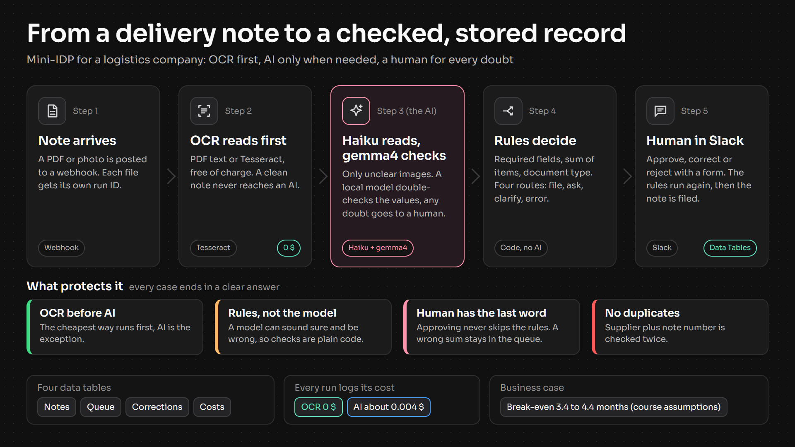
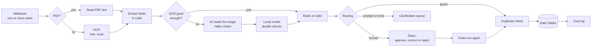
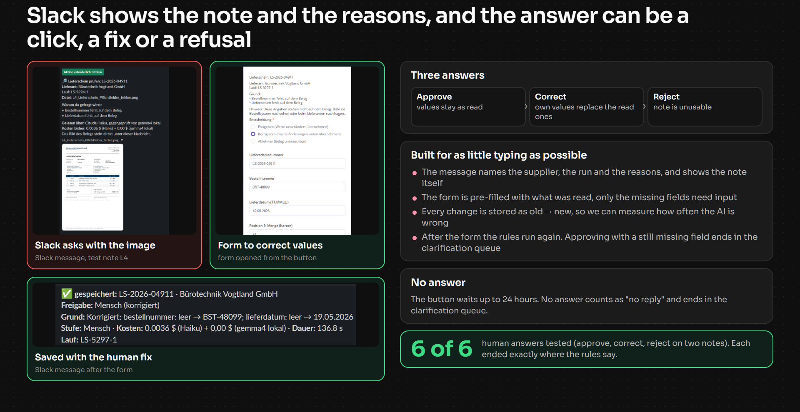
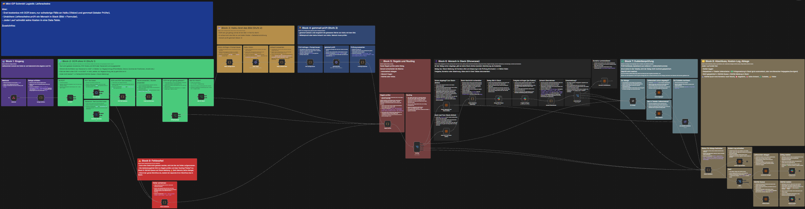
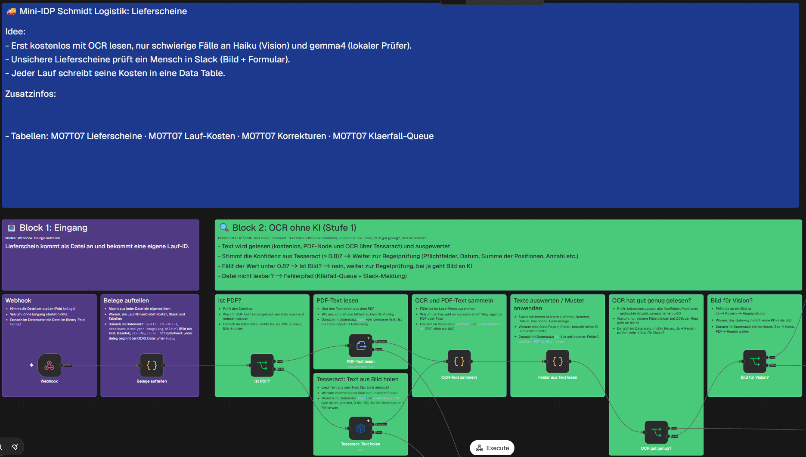
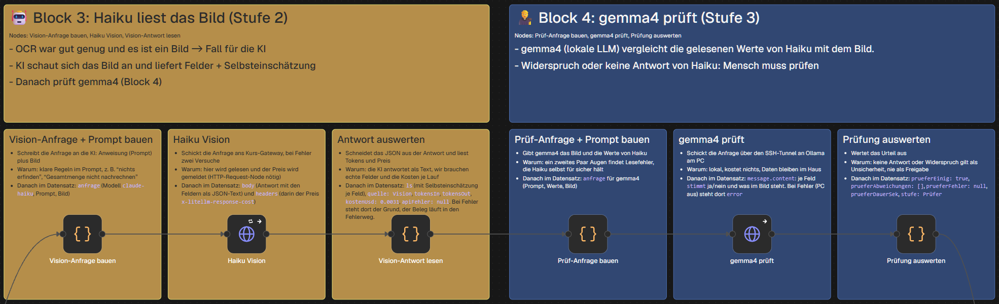
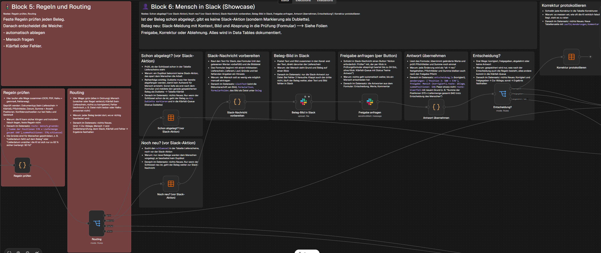
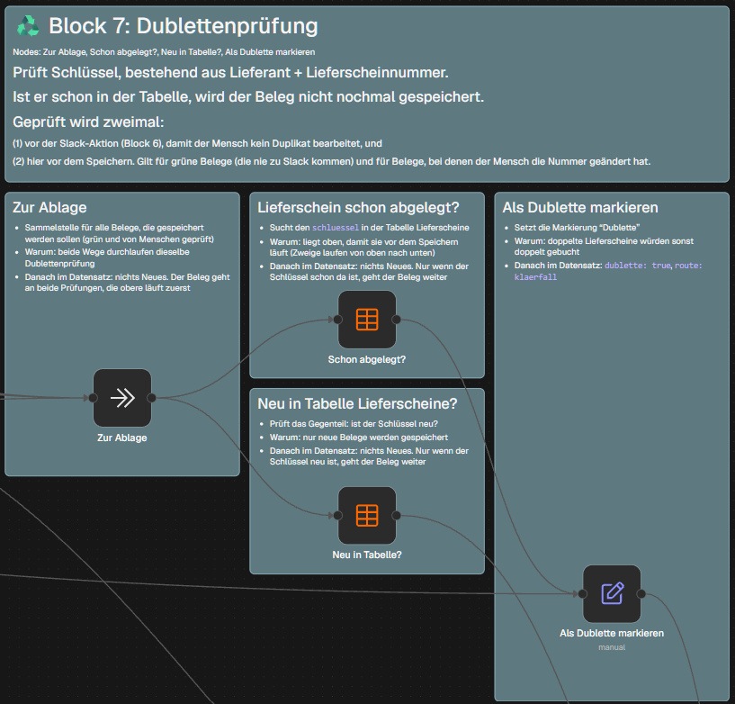
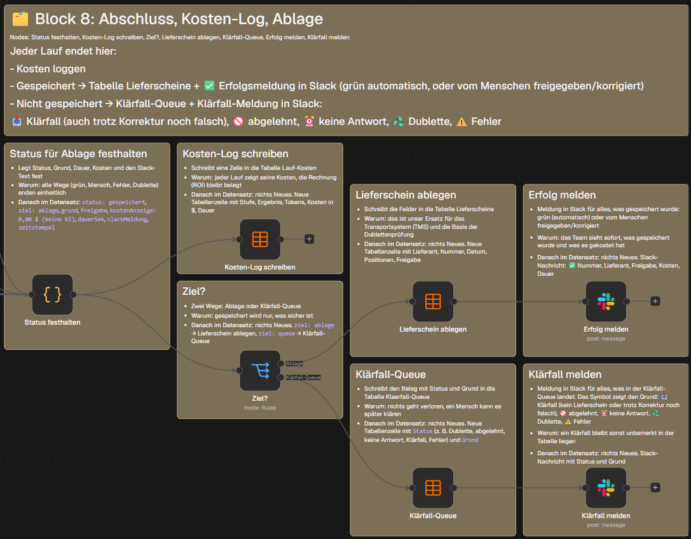

# Mini-IDP: Delivery Notes

A logistics company receives about 180 delivery notes a day and keys each one into its transport system by hand.\
This workflow reads every note with free OCR first.\
An AI model reads only the unclear ones, and a local model double-checks them.\
Fixed rules then decide, a person in Slack resolves anything doubtful, and the result is stored together with the cost of every run.

**Scope:** file intake, OCR, AI reading with a second-model check, rule checks, human approval in Slack, a duplicate check, storage in n8n Data Tables and a cost log.\
**Not included:** a real transport-system connection (a table stands in for it).

This is a course project for a fictional company (Schmidt Logistik).\
The notes inside the workflow and the Slack texts are in German, while this page, the walk-through and the test plan are in English.

## 🏗️ Architecture

## ▶️ Walk-through

Each page covers one step of the path.\
Open them in the browser ([source files in `page/`](page/)) or look at the images here.

| Step | What you see | Page |
|---|---|---|
| 1 | Every note is read by free OCR first, and only unclear ones reach the AI | [open](https://markus-piljanovic.github.io/automation-portfolio/workflows/mini-idp-schmidt/page/01-intake.html) |
| 2 | Haiku reads the image, and a local model double-checks it | [open](https://markus-piljanovic.github.io/automation-portfolio/workflows/mini-idp-schmidt/page/02-ai-reading.html) |
| 3 | Fixed rules in code decide where each note goes | [open](https://markus-piljanovic.github.io/automation-portfolio/workflows/mini-idp-schmidt/page/03-rules-and-routing.html) |
| 4 | Slack shows the note and the reasons, and the answer is a click, a fix or a refusal | [open](https://markus-piljanovic.github.io/automation-portfolio/workflows/mini-idp-schmidt/page/04-human-in-slack.html) |
| 5 | The same note is never stored twice | [open](https://markus-piljanovic.github.io/automation-portfolio/workflows/mini-idp-schmidt/page/05-duplicates-and-storage.html) |
| 6 | Every run logs its cost, and the business case rests on that log | [open](https://markus-piljanovic.github.io/automation-portfolio/workflows/mini-idp-schmidt/page/06-cost-and-value.html) |

## ⚙️ The workflow

| Workflow | File | Job |
|---|---|---|
| Mini-IDP (Schmidt Logistik) | `mini-idp-schmidt.json` | Webhook in, OCR, AI reading, rules, Slack approval, duplicate check, storage and cost log |

The sticky notes on the canvas explain every node: what happens, why, and what is in the data afterwards.\
They are written in German.

| Blocks 1 and 2: intake and OCR | Blocks 3 and 4: AI reading |
|---|---|
|  |  |

| Blocks 5 and 6: rules and Slack | Block 7: duplicates | Block 8: finish |
|---|---|---|
|  |  |  |

## ⚖️ Decisions and trade-offs

| Problem | Decision | What I gave up |
|---|---|---|
| 180 notes a day must not all pass through an AI | OCR first, and AI only for unclear images | An unclear photo costs about 0.004 $ and 22 seconds |
| A model can sound certain and still be wrong | A second, local model double-checks, then plain rules decide | Any doubt goes to a human, so there are more questions |
| A human click must not push a bad note through | The rules run again after the form | A person cannot force a wrong note into the table |
| The same note can arrive twice | Supplier plus note number is checked before Slack and before saving | Only exact matches count as duplicates |
| The local model can be offline | Every AI-read note then goes to a human | More manual work while the tunnel is down |

## 💰 Cost and value

**Scope:** the figures cover workflow running costs, build effort and saved handling time.\
Training, extra hardware and the cost of errors are not included.\
All inputs are assumptions from the course data sheet, not measurements at the company: 180 notes a day, 1.5 minutes each and 30 € an hour for the clerk.

| | Cautious | Moderate | Optimistic |
|---|---|---|---|
| Notes handled without a human | 70 % | 75 % | 80 % |
| Investment (build and scanner) | 6,400 € | 5,050 € | 4,600 € |
| Running cost a month | 260 € | 210 € | 160 € |
| Net saving a month | 2,370 € | 2,469 € | 2,568 € |
| Break-even | 4.4 months | 3.7 months | 3.4 months |
| Net benefit in the first year | 24,495 € | 25,611 € | 26,724 € |

Today the process costs about 2,920 € a month in handling time.\
The measured part is the cost per run: 0 $ for OCR, 0.003 to 0.005 $ for a note read by Haiku and 0 $ for the local model.\
The share of notes handled without a human remains an assumption until real notes are logged.

## ⚠️ Known limits

- The webhook has no authentication, so header auth should be added before real use.
- The local model runs on a PC and is reached through an SSH tunnel.\
  With the tunnel closed, every AI-read note goes to a human, and a cold start of the model takes about a minute.
- Not tested yet: a delivery note as a PDF with a text layer, the rule for handwritten remarks, and the clean-note path after the last changes.
- The Data Tables stand in for a transport system, so there is no real integration.
- The business case rests on course assumptions (see above).
- There is no error workflow in this package, and no retention or deletion rule for the stored notes.

## ✅ Testing

[Open the test plan in your browser](https://markus-piljanovic.github.io/automation-portfolio/workflows/mini-idp-schmidt/testing/test-plan.html) ([source file](testing/test-plan.html)).\
Inputs and expectations are in [`testing/cases.json`](testing/cases.json).\
The fictional test notes are in [`testing/test-notes/`](testing/test-notes/).

| Group | Cases | Purpose |
|---|---|---|
| Normal delivery notes | 3 | Clean, handwritten and US format |
| Wrong documents and broken files | 3 | Advertising, tax notice, broken image |
| Rules ask a human | 2 | Missing fields, wrong sum |
| What the human can answer | 6 | Approve, correct and reject on two notes |
| Duplicates | 2 | The same note sent twice |
| Not tested yet | 2 | Listed |

16 of 18 cases ran and passed, and 2 are open.\
Every case ran against the real workflow with a real file.

## 🚀 Run it yourself

1. Import `mini-idp-schmidt.json` into n8n and install the community node `n8n-nodes-tesseractjs`.
2. Create four Data Tables and replace the `YOUR_TABLE_ID_*` placeholders:

| Table | Columns |
|---|---|
| Lieferscheine | Schluessel, LaufId, Dateiname, Lieferant, Lieferscheinnummer, Bestellnummer, Lieferdatum, Empfaenger, Positionen, Gesamtmenge, Notizen, FahrerUnterschrift, Quelle, Freigabe, Zeitstempel |
| Lauf-Kosten | LaufId, Dateiname, Stufe, Ergebnis, Grund, TokensIn, TokensOut, KostenUsd, KostenQuelle, DauerSek, Zeitstempel |
| Korrekturen | LaufId, Lieferscheinnummer, Aenderungen, AnzahlAenderungen, Kommentar, Zeitstempel |
| Klaerfall-Queue | LaufId, Dateiname, Status, Grund, Lieferant, Lieferscheinnummer, Zeitstempel |

3. Create credentials for the AI gateway (an OpenAI-compatible endpoint with a `claude-haiku` model) and for Slack.\
   Then replace `YOUR_AI_GATEWAY_CREDENTIAL_ID`, `YOUR_SLACK_CREDENTIAL_ID` and `YOUR_SLACK_CHANNEL_ID`.
4. Replace `YOUR_OLLAMA_HOST` with the address of a machine running Ollama with the `gemma4` model.
5. Optional: set an error workflow in the workflow settings (it is not part of this package).
6. Send a note: `curl -X POST -F "beleg1=@L5_Lieferschein_Mengen_Widerspruch.png" https://your-n8n-host.example/webhook/m07t07-lieferschein`
